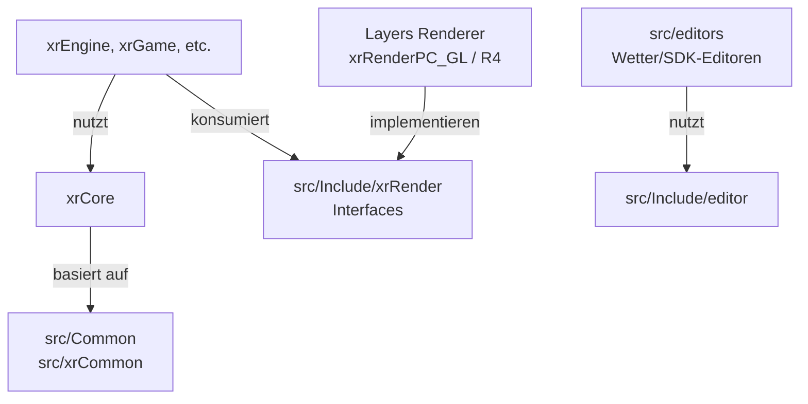

# Foundation: xrCore, xrCommon, Common & Include

> Deutsche Entwickler-Dokumentation des OpenXRay/xray-16-Projekts (Engine-Basis-Schicht).
> Pfade sind relativ zum Projekt-Stammverzeichnis (`xray-16/`) angegeben.

## Einleitung

Die Foundation-Schicht besteht aus der Low-Level-Bibliothek **`xrCore`** sowie mehreren zentralen Header-Sammlungen (`src/xrCommon`, `src/Common`, `src/Include`). Hier liegen Speicherverwaltung, das virtuelle Dateisystem, Mathematik, Strings, Kompression, Kryptografie, Threading, XML-/INI-Parsing, Logging und das Datenmodell für Skelett-Animationen. Praktisch jedes Modul der Engine baut – direkt oder indirekt – auf `xrCore` auf.

| Bereich | Umfang | Rolle |
|---------|--------|-------|
| `src/xrCore` | ~157 Dateien | Zentrale Low-Level-Bibliothek |
| `src/xrCommon` | 15 Header | Moderne STL-Container-Wrapper & Mathe-Helfer (header-only) |
| `src/Common` | ~30 Dateien | Geteilte Plattform- und Utility-Header |
| `src/Include` | 3 Unterordner | Öffentliche Schnittstellen-Header (Editor, xrAPI, Renderer-Interfaces) |
| `src/dummy` | 1 Quelldatei | Platzhalter-Target für die Visual-Studio-Solution |

---

## 1. `src/xrCore` – Low-Level-Kernbibliothek

### Zweck & Verantwortung

`xrCore` liefert die Grunddienste der Engine: Speicher, Dateisystem, Mathe, Strings, Zeit, Konfiguration, Kompression, Krypto, Threading, Logging, Debug-Support und Animations-Datenmodelle.

### Verzeichnisstruktur

| Pfad | Inhalt |
|------|--------|
| `Animation/` | Datenmodell für Skelette und Bone-Animationen: `Bone`, `Motion`, `SkeletonMotions`, `SkeletonMotionDefs`, `Envelope`, `interp`, `BoneEditor` |
| `Compression/` | LZO-Compressor (`lzo_compressor.*`), PPMD (`ppmd_compressor.*`, `PPMd.*`, `SubAlloc.hpp`, `Model.cpp`, `PPMdType.h`), Runtime-Rekompression (`rt_compressor.*`, `rt_compressor9.cpp`), Streams (`compression_ppmd_stream*`), allgemeiner Coder (`Coder.hpp`) |
| `Containers/` | `AssociativeVector.hpp` (sortierter Vector-Map-Hybrid), `FixedMap.h` |
| `Crypto/` | `xr_dsa.*` (DSA), `xr_dsa_signer.*` / `xr_dsa_verifyer.*` (Signaturprüfung), `xr_sha.*` (SHA-Hash), `trivial_encryptor.*` (einfache Verschlüsselung) |
| `Debug/` | `dxerr.*` + zugehörige `.inl`-Dateien (DirectX-Fehlercodes/-meldungen), `StackTrace.*` |
| `Events/` | `Notifier.h` (Beobachter-/Notifier-Pattern) |
| `Math/` | `Random32.hpp`, `fast_lc16.*` (schneller RNG) |
| `Media/` | `Image.*` (Bild-Laden), `ImageJPEG.cpp` (JPEG-Decoder) |
| `Memory/` | `xalloc.h` (STL-kompatibler Allocator), `xrMemory_align.*` |
| `PostProcess/` | `PostProcess.*`, `PPInfo.*` (Datenmodell für Post-Process-Blends/Farbkorrektur) |
| `Text/` | `StringConversion.*` (Zeichenkonvertierung, z. B. UTF-16 ↔ UTF-8) |
| `Threading/` | `Lock`, `ScopeLock`, `Event`, `ThreadUtil`, parallele Algorithmen (`ParallelFor.hpp`, `ParallelForEach.hpp`), Job-System (`Task.hpp`, `TaskManager.*`) |
| `XML/` | TinyXML (`tinyxml*`, `tinystr`) und der Wrapper `XMLDocument.*` |

### Wichtige Dateien (Top-Level)

| Datei | Aufgabe |
|-------|---------|
| `FS.h`, `LocatorAPI.h/.cpp`, `FileSystem.*`, `FS_impl.h`, `FS_internal.h` | **Virtuelles Dateisystem (VFS):** lädt `*.db*`-Archive, löst logische Pfade zu Dateien/Archiveinträgen auf, stellt Reader/Writer bereit |
| `xrMemory.h/.cpp` | **Speicher-Manager:** `mem_alloc`/`mem_realloc`/`mem_free` (inkl. Alignment-Varianten und `small_alloc`) |
| `xrDebug.h/.cpp`, `log.*` | Asserts, Fehler-Handler, Logging |
| `xr_ini.h/.cpp` | Parser für X-Ray-Konfigurationsdateien (`CInifile`, im Spiel typischerweise `.ltx`-Dateien) |
| `_math.h`, `_vector2/_vector3d/_vector4.h`, `_matrix.h`, `_matrix33.h`, `_quaternion.h`, `_fbox.h`, `_fbox2.h`, `_sphere.h`, `_plane.h`, `_obb.h`, `_cylinder.h`, `_color.h`, `_flags.h`, `_random.h`, `_rect.h` | **Mathe-Basistypen** (Fvector, Fmatrix, Fquaternion, Fbox, Flags, Farben u. a.) – das Standard-Vokabular aller Engine-Module |
| `xrstring.h/.cpp` | **`shared_str`**: referenzgezählter String-Typ |
| `stream_reader.*`, `file_stream_reader.*` | Binäre Reader-Streams mit Seek-Support |
| `buffer_vector*.h` | Vektor mit fester, inline/stack-Kapazität |
| `LzHuf.cpp`, `lzhuf.h` | LZ+Huffman-Kompression (Legacy) |
| `clsid.*` | CLSID-Verwaltung für Klassenfabriken |
| `crc32.*`, `FileCRC32.*` | Prüfsummen |
| `net_utils.h`, `NET_utils.cpp`, `client_id.h` | Basis-Utilities für den Netzwerk-Code (u. a. Client-ID-Typ) |
| `ModuleLookup.*` | Plattformagnostisches Laden von DLLs/Shared Libraries |
| `FTimer.*` | Timer für Performance-Messungen |
| `os_clipboard.*` | Zugriff auf die System-Zwischenablage |
| `fastdelegate.h`, `intrusive_ptr.h`, `cdecl_cast.hpp` | Delegates, intrusive Referenzzählung, Calling-Convention-Cast |
| `xr_token.*`, `xr_trims.*`, `dump_string.*`, `string_concatenations.*` | Tokenizer, String-Bereinigung, Debug-Dumps, effiziente String-Verkettung |
| `xr_types.h`, `math_constants.h`, `xr_resource.h`, `xr_shared.*`, `xrsharedmem.*`, `xrPool.h`, `vector.h`, `FixedVector.h` | Basis-Typen, Konstanten, Shared-Objekte, Objekt-Pools |
| `_compressed_normal.*` | Komprimierte Vertex-Normalen |
| `_std_extensions.*`, `_stl_extensions.*` | Erweiterungen für Standard-Bibliotheks-Verhalten |

### Kernkomponenten im Detail

#### Speicherverwaltung (`xrMemory`)

Alle Engine-Module allokieren über zentrale Funktionen (`src/xrCore/xrMemory.h`):

```cpp
void* mem_alloc(size_t size);
void* mem_realloc(void* ptr, size_t size);
void  mem_free(void* ptr);
void* small_alloc(size_t size); // kleine Blöcke -> Small-Block-Allocator
```

Darauf bauen die Komfort-Funktionen `xr_alloc<T>(count)`, `xr_free(ptr)` sowie

```cpp
T* xr_new(Args&&... args);  // mem_alloc + placement-new
void xr_delete(T*& ptr);    // Destruktor + mem_free, setzt ptr auf nullptr
```

`struct small_buffer` zeigt das typische Muster: Größen bis `xrMemory::SMALL_SIZE_MAX` gehen an den Small-Block-Allocator, größere an `mem_alloc`. Vorteile: zentrale Speicherstatistiken, Leak-Tracking, konsistentes Debugging.

#### `shared_str` (referenzgezählter String)

`src/xrCore/xrstring.h` definiert die Klasse `shared_str` mit einem internen `str_value*`-Pointer und Referenzzählung (`dwReference`, `_dec()`). Strings werden thereby einmal gespeichert und mehrfach referenziert – X-Rays Standard-Stringtyp für Namen, Config-Werte und Schnittstellen aller Module.

#### Virtuelles Dateisystem (`FS` / `CLocatorAPI`)

Das VFS (`FS.*`, `LocatorAPI.*`, `FileSystem.*`) ist einer der zentralen Engine-Dienste: S.T.A.L.K.E.R. liefert Inhalte fast vollständig in `*.db*`-Archivpaketen. Der Locator

- registriert Archive und Verzeichnisse beim Start,
- bildet **logische Pfade** (z. B. `$game_data$`, `$game_scripts$`, `$ Level$`) auf reale Dateien und Archiveinträge ab,
- stellt `IReader`/`IWriter`-Streams (siehe `stream_reader.h`) für binäres, seekfähiges Lesen/Schreiben bereit (Basis für Meshes, Saves, Netz-Pakete),
- prüft optional CRC32 (siehe `FileCRC32`, `crc32`).

#### Mathe-Bibliothek

Eigenständige, minimalistische Mathe-Sammlung statt externer Bibliothek: Vektoren, Matrizen (3×4), Quaternionen, Bounding-Primitiven (`Fbox`, `Fsphere`, `Fobb`, `Fcylinder`, `Fplane`), Farbtypen und Flag-Container. Ergänzt durch `src/xrCommon/math_funcs.h` und `Math/Random32.hpp` (schneller Zufallsgenerator).

#### Konfiguration: `CInifile` und XML

- `CInifile` (`xr_ini.*`): Parser für das klassische X-Ray-Konfigurationsformat (Sektionen `[name]`, `key = value`, Zeilenkommentare). Grundlage fast aller Game-Configs (`.ltx`).
- `XMLDocument` (`XML/`): Wrapper um das eingebettete TinyXML für UI-Layouts, Skript-Konfigurationen, Beschreibungen.

#### Threading & Job-System

`Threading/` bietet neben klassischen Primitiven (`Lock`, `ScopeLock`, `Event`) parallele Algorithmen (`ParallelFor`) und einen `TaskManager` für die Verteilung von Aufgaben auf Worker-Threads (genutzt z. B. von Streaming, Physik und Dem kleinen Multiplayer-Balancer).

#### Kompression & Krypto

- **LZO** – schnelle Echtzeitkompression, primary für Netz-Pakete/Streams (z. B. Level-Downloads, Save-Kompression – verifikationsbedürftig im Detail).
- **PPMD** – Kompressionsmodell für größere Datenblöcke (`Model.cpp`, `SubAlloc.hpp`).
- **rt_compressor** – Runtime-Rekompression zwischen Formaten (`rt_compressor9.cpp` ist ein D3D9-Zeit-Rest).
- **Crypto** – DSA-Signaturprüfungen (z. B. Client-/Server-Authentifizierung, MP-Master-Server-Kommunikation) und SHA-Hashing.

---

## 2. `src/xrCommon` – STL-Wrapper & Helfer

Kleine, header-only Collective moderner Container-Wrapper, die konsequent den Engine-eigenen Allocator (`xr_allocator.h`) verwenden:

| Datei | Inhalt |
|-------|--------|
| `xr_vector.h`, `xr_array.h`, `xr_map.h`, `xr_set.h`, `xr_list.h`, `xr_deque.h`, `xr_stack.h`, `xr_unordered_map.h` | Container-Typen mit Engine-Allocator |
| `xr_string.h`, `xr_smart_pointers.h` | String- und Smart-Pointer-Wrapper |
| `math_funcs.h(_inline.h)`, `misc_math_types.h` | Mathe-Helfer |
| `predicates.h` | Vergleichsprädikate für Sortierung/Suche |

**Zweck:** einheitliche Speichernutzung, Debug-Support und konsistente Schnittstellen überall im Code; im Gegensatz zu `xrCore` strikt header-only und frei von Legacy-Abhängigkeiten.

---

## 3. `src/Common` – geteilte Plattform- und Utility-Header

Ältere, projektweit geteilte Header (werden über `xrCore` per CMake-Gruppe „Common“ mitgebaut):

| Datei(en) | Aufgabe |
|-----------|---------|
| `Platform.hpp` + `Platform{Windows,Linux,BSD,Apple}.inl`, `Compiler.inl` | Plattform-/Compiler-Weichen für alle Ziel-OS |
| `Common.hpp`, `Config.hpp`, `Util.hpp` | zentrale Includes, Build-Config, Utility-Makros |
| `object_broker.h`, `object_cloner.h`, `object_comparer.h`, `object_destroyer.h`, `object_interfaces.h`, `object_loader.h`, `object_saver.h`, `object_type_traits.h` | generische Serialisierungs-/Kopier-/Zerstör-Helfer (Template-Bibliothek) |
| `FSMacros.hpp` | Dateisystem-Makros |
| `LevelGameDef.h`, `LevelStructure.h` | Level-Basisdefinitionen |
| `OGF_GContainer_Vertices.hpp`, `face_smoth_flags.h` | OGF-Mesh-Vertex-Container, Smoothing-Flags |
| `GUID.hpp`, `Noncopyable.hpp` | GUID-Typ, Noncopyable-Basis |
| `d3d9compat.hpp` | D3D9-Kompatibilitätsreste |
| `NvMender2003/` | Ordner mit Mesh-Normalen-/Winding-Fix-Code (ursprünglich von NVIDIA) |

---

## 4. `src/Include` – öffentliche Schnittstellen-Header

| Unterordner | Inhalt |
|-------------|--------|
| `editor/` | `engine.hpp`, `ide.hpp`, `interfaces.hpp`, `property_holder_base.hpp` – Schnittstellen für eingebettete Editoren (genutzt von `src/editors`) |
| `xrAPI/` | `xrAPI.h` – globaler API-Zugriffspunkt; darin ist das Singleton, über das Module auf Engine-Subsysteme zugreifen (Details siehe `docs/03-rendering.md`) |
| `xrRender/` | ~30 **abstrakte Renderer-Schnittstellen** (z. B. `RenderFactory.h`, `RenderVisual.h`, `DebugRender.h`, `FacadePtr.h`, `FontRender.h`, `EnvironmentRender.h`, `Kinematics.h`, `UIRender.h`, `RainRender.h`, `ThunderboltRender.h`, `LensFlareRender.h` und mehr) – die konkreten Renderer (`Layers/xrRenderPC_*`, `xrRenderGL*`) implementieren diese Interfaces |

> Hinweis: `Include/xrAPI/xrAPI.h` ist die zentrale, modulübergreifende Zugriffsschicht; die markanten Header in `Include/xrRender/` sind die Schnittstellen, die `xrEngine` render-agnostisch konsumiert. Das Render-Kapitel (`docs/03-rendering.md`) behandelt die Implementierungen.

---

## 5. `src/dummy` – Platzhalter-Target

Enthält nur `00dummy_tester.cpp` plus MSVC-Projektdateien. Es ist ein Hilfs-/Platzhalter-Target für die Visual-Studio-Solution (kein Teil des CMake-Builds – Klassiker für alte Solution-Strukturen).

---

## Zusammenspiel & Abhängigkeiten



- `xrCore` ist die einzige Basis-Bibliothek – alles darüber hängt von ihr ab (Engine, Renderer, Spiel, Netz).
- `Include/xrRender` definiert die Render-Abstraktionsschicht; `xrEngine` arbeitet gegen diese Interfaces, während die Renderer-Backends (GL/DX11) sie implementieren.
- `xrAICore`, `xrGame`, `xrNetServer` etc. nutzen alle `CInifile`, `FS`, `shared_str`, Mathe-Typen und `xrMemory`.

## Hinweise für Entwickler & Modder

- **Neuer Code** sollte `shared_str` für Strings, die `xr_*`-Container aus `xrCommon` und `xr_new`/`xr_delete` für Objekte verwenden – das hält Speicherstatistiken und Debug-Ausgaben konsistent.
- **Configs** liegen fast immer im INI-Format vor: `CInifile` in `xr_ini.h` ist der offizielle Parser; UI-Definitionen nutzen `XMLDocument`.
- **Plattformcode** gehört in die `Platform*.inl`-Struktur (BSD/Apple/Linux/Windows) – neue Plattform-Ifdef-Wände in Spielmodulen vermeiden.
- Beim Erweitern des Renderers immer die **Interfaces** in `src/Include/xrRender/` erweitern und in **allen** Backends implementieren.

---
*Dokumentationsbasis: Verzeichnislisten, `src/xrCore/CMakeLists.txt`, direkte Inspektion von `xrMemory.h` und `xrstring.h`. Detailtiefere Aussagen (z. B. exakte Verwendungszwecke einzelner Kompressoren) sind teilweise aus Struktur und Dateinamen abgeleitet und entsprechend vorsichtig formuliert.*
