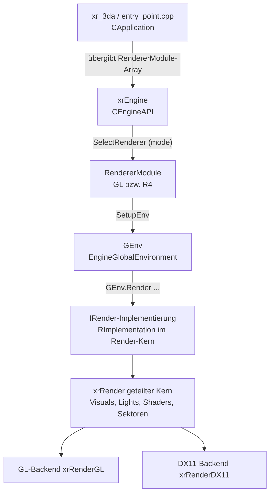

# Rendering: xrRender, Backends, xrMaterialSystem & xrAPI

> Deutsche Entwickler-Dokumentation des OpenXRay/xray-16-Projekts (Rendering-Schicht).
> Pfade relativ zum Projekt-Stammverzeichnis.

## Einleitung

Die Rendering-Schicht liegt unter `src/Layers/` und gliedert sich in:

1. **Schnittstellen** (`src/Include/xrRender/`, `src/Include/xrAPI/xrAPI.h`) – abstrakte Renderer-API,
2. **geteilter Render-Kern** (`src/Layers/xrRender/`) – backend-agnostische Implementierung,
3. **Deferred-Pipeline** (`src/Layers/xrRender_R2/`) – R2/R3/„RGL“-Renderstufen, gemeinsam für alle Backends,
4. **Backends**: OpenGL (`src/Layers/xrRenderGL/` + `src/Layers/xrRenderPC_GL/`) und DirectX 11 (`src/Layers/xrRenderDX11/` + `src/Layers/xrRenderPC_R4/`),
5. **Materialbibliothek** (`src/xrMaterialSystem/`),
6. **Globale API** (`src/Layers/xrAPI/`, definiert `GEnv`).

---

## Architektur-Überblick



### Das Service-Locator-Muster: `GEnv`

`src/Include/xrAPI/xrAPI.h` deklariert und `src/Layers/xrAPI/xrAPI.cpp` definiert die **globale Engine-Umgebung**:

```cpp
class XRAPI_API EngineGlobalEnvironment
{
public:
    IRender* Render;
    IDebugRender* DRender;
    CDUInterface* DU;
    IUIRender* UIRender;
    IRenderFactory* RenderFactory;
    CScriptEngine* ScriptEngine;
    AISpaceBase* AISpace;
    ISoundManager* Sound;
    UICore* UI;
    bool isDedicatedServer;
};

extern XRAPI_API EngineGlobalEnvironment GEnv;
```

Alle Engine-Module greifen über diese globalen Zeiger auf die Subsysteme zu (Render, Sound, Skript, KI, UI) – unabhängig davon, welche konkrete Implementierung dahintersteckt.

### Renderer-Module: Auswahl zur Laufzeit

Jedes Backend exportiert im eigenen Namensraum `xray::render::<ns>::GetRendererModule()` (`src/Include/xrRender/xrRender.h`):

- `xray::render::render_gl::GetRendererModule()` → GL-Renderer (`XRRENDER_GL_API`)
- `xray::render::render_r4::GetRendererModule()` → DX11-Renderer (`XRRENDER_R4_API`)

Der Programm-Einstiegspunkt (`src/xr_3da/entry_point.cpp`) baut das Array:

```cpp
std::array<RendererModule*, 2> s_render_modules =
{
#ifdef XR_PLATFORM_WINDOWS
    xray::render::render_r4::GetRendererModule(),
#endif
    xray::render::render_gl::GetRendererModule(),
};
```

`CApplication` (in `src/xrEngine/x_ray.h`) erhält dieses Array zusammen mit dem Spielmodul (`GameModule*`, deaktiviert per Startparameter `-nogame`). Die Auswahl übernimmt `CEngineAPI` (`src/xrEngine/EngineAPI.h`): Sie verwaltet die Map `renderModes`, trifft per `SelectRenderer()` die Wahl anhand der unterstützten Modi/Hardwareprüfung und ruft danach `SetupEnv(mode)` des gewählten Moduls auf, das die `GEnv`-Zeiger auf die konkreten Implementierungen (z. B. `GEnv.Render = &RImplementation`) setzt. `ClearEnv()` räumt sie beim Beenden wieder ab.

**Verfügbare Renderer-Modi** (Konsolenvariante `renderer_<name>`; IDs aus `xrRender_gl.cpp` / `xrRender_R4.cpp`):

| Modi | ID | Bedeutung |
|------|----|-----------|
| `renderer_r2a` | 1 | R2 „advanced“ – Static-Sun; im R4-Modul deaktiviert (vanilla-Shader kompiliert nicht) |
| `renderer_r2` | 2 | Deferred, einfaches Post-Processing (`ps_r2_advanced_pp = false`) |
| `renderer_r2.5` | 3 | Deferred + erweitertes Post-Processing |
| `renderer_r3` | 4 | Deferred + DX10/11-Klasse (GL-Standard außerhalb Windows) |
| `renderer_r4` | 5 | DX11-Variante mit moderneren Techniken |
| `renderer_rgl` | 6 | GL-spezifischer Modus (nur Windows-Angebot des GL-Moduls) |

Des Weiteren prüft jedes Modul vor Aktivierung, ob die Shader vorhanden sind: `FS.exist("$game_shaders$", RImplementation.getShaderPath())` – fehlen sie, wird der Renderer nicht angeboten.

---

## Build-Struktur (CMake)

Aus `src/Layers/CMakeLists.txt` ergibt sich:

| Target | Plattform | kompiliert | Defines |
|--------|-----------|------------|---------|
| `xrAPI` | alle | `src/Layers/xrAPI/xrAPI.cpp` (GEnv) | `XRAPI_API` (Import/Export) |
| `xrRender_GL` | **alle** (Standard) | `xrRender`-Kern + `xrRender_R2` + `xrRenderGL` + eigene GL-Dateien | `USE_OGL`, `RENDER_NAMESPACE=render_gl`, `XRRENDER_GL_EXPORTS` |
| `xrRenderPC_R4` | **nur `WIN32`** | nur die eigenen 13 Dateien (r4_*) | `USE_DX11`, `XRRENDER_R4_EXPORTS` |

Wichtige Details aus `src/Layers/xrRenderPC_GL/CMakeLists.txt`:

- Das GL-Target kompiliert die geteilten Quellen aus `../xrRender/`, `../xrRender_R2/` und `../xrRenderGL/` **mit in das Target `xrRender_GL`** – es gibt kein separates „xrRender“-Target. Einige Legacy-Blender (D3D9-Ära) sind darin auskommentiert, ebenso `Texture.cpp`, `stats_manager.*`, `SH_Texture.cpp` und `ResourceManager_Scripting.cpp` (letzteres existiert GL-seitig als `glResourceManager_Scripting.cpp`).
- GL nutzt den GL-Loader **glad** (`sdk/include/glad/gl.c/.h`, `KHR/khrplatform.h`) und `gli` (DDS-Texturen, `Externals/gli`).
- `target_link_libraries(xrRender_GL …)`: `xrAPI, xrCDB, xrCore, xrEngine, xrMaterialSystem, xrParticles, xrScriptEngine, xrImGui` (Dev-UI).
- Das R4-Target kompiliert im CMake-Build **nur** seine eigenen Dateien und linkt `xrCore, xrCDB, xrEngine, xrParticles, xrScriptEngine, xrAPI, xrMiscMath`. Die in `xrRender_R4.cpp` eingebundenen geteilten Header (`Layers/xrRender/dxRenderFactory.h` etc.) setzen voraus, dass der geteilte Kern mit hineinkompiliert wird (Windows-Build via Visual-Studio-Solution `src/engine.sln` bzw. `xrRender_R4.vcxproj`); im CMake-Build ist der R4-Pfad diesbezüglich noch in Arbeit (Hinweis: Der Ordner `xrRenderDX11` wird von keinem CMake-Target referenziert). Für Linux/macOS ist der GL-Renderer der primäre Weg.

---

## `src/Layers/xrRender` – geteilter Render-Kern (~293 Dateien)

Backend-agnostische Implementierung, die gemeinsam mit dem jeweiligen Backend kompiliert wird (Ordneruntergruppen: `blenders/`, `Utils/`, `Debug/`).

### Visuals (Meshes & Modelle)

| Datei(en) | Aufgabe |
|-----------|---------|
| `FBasicVisual.*`, `FVisual.*`, `FHierrarhyVisual.*` | Basisklasse für Render-Visuals, statische Meshes, Hierarchien |
| `FSkinned.*`, `SkeletonX.*`, `SkeletonAnimated.*`, `SkeletonCustom.*`, `SkeletonRigid.cpp`, `SkeletonXSkinXW_*(CPP|SSE).*` | Skelett-Deformation (Skinning) mit SSE- und C++-Pfad; animierte Skeletons |
| `FTreeVisual.*` | Vegetation/Bäume |
| `FProgressive.*` | Progressive Meshes (LOD/Streaming-Kennzahl...) |
| `FLOD.*` | LOD-Darstellung |
| `ModelPool.*` | Pool/Instanzierung geladener Modelle |
| `Animation.*`, `AnimationKeyCalculate.h`, `KinematicAnimatedDefs.h`, `KinematicsAddBoneTransform.hpp` | Keyframe-Berechnung, kinematische Defs |

### Beleuchtung

| Datei(en) | Aufgabe |
|------|---------|
| `light.*`, `Light_DB.*`, `Light_Package.*` | Licht-Objekte, Licht-Datenbank/-Paket |
| `LightTrack.*`, `light_smapvis.*`, `light_vis.*`, `light_gi.*` | Licht-Tracking, Shadowmap-Sichtbarkeit, Global Illumination-Anteile |
| `Light_Render_Direct.*` (+ `…_ComputeXFS.cpp`) | Sonne/Direktlicht inkl. Transform-Berechnung |
| `r_sun_cascades.h` | Kaskaden für Sun-Shadowmaps |

### Shader-System & „Blender“

Der X-Ray-Shader-Aufbau: **Blender** (= Shader-Beschreibungsobjekt, das je Renderpass Shader, Renderzustände und Texturen kombiniert) + **ResourceManager** (lädt/verwaltet Shader-Code, Texturen, Konstanten) + **R_Backend** (zustandsarme Sammlung von Runtime-Handles).

| Datei(en) | Aufgabe |
|-----------|---------|
| `Blender.*`, `Blender_CLSID.h`, `Blender_Recorder.*` (+ `_R2`, `_StandartBinding`) | Blender-Basisklasse, CLSIDs, Recorder (nimmt Rendering-Pass-Befehle auf) |
| `blenders/blender_combine.*` | Kombinierungs-Pass (Endkomposition...) |
| `blenders/blender_bloom_build.*`, `blenders/blender_luminance.*` | Bloom/Luminanz-Stufen (HDR) |
| `blenders/blender_light_direct(_cascade).*, point, spot, occq, reflected, mask` | Licht-Akkumulations-Pässe (Deferred) |
| `blenders/blender_ssao.*` | Screen-Space Ambient Occlusion |
| `blenders/blender_deffer_flat/model.*, deffer_aref, detail_still_deferred, tree_deferred, particle_deferred, Blender_Model_EbB_deferred` | Surface-Shader-Varianten (deferred) |
| `blenders/uber_deffer.*` | Kombinierter Pass für Oberflächen (deferred-basiertes Uber-Shader-Konzept) |
| `blenders/Blender_Editor_Selection/Wire.*`, `Blender_Lm(EbB).*`, `Blender_Screen_SET.*` | Editor-Hervorhebung, Lightmaps (Legacy), Screen-Effekt-Shader |
| `blenders/glMinMaxSMBlender.cpp, glMSAABlender.cpp, glRainBlender.cpp` (+ `dx11…`-Pendants) | GL/DX11-Spezialpasses: MinMax-Shadowmap, MSAA-Edges, Regen |
| `Shader.*`, `SH_Atomic.*`, `SH_Constant.*`, `SH_Matrix.*`, `SH_RT.h`, `SH_Texture.h` | Shader-Objektmodell (Konstanten, Matrizen, Render-Targets, Texturen) |
| `r_constants*.*`, `r_constants_cache.h` | Konstanten-Caching |
| `ResourceManager*.*` | zentrale Resource-Verwaltung (Shader, RTS, Texturen, Blenders); Skripting siehe GL-Pendant |
| `ShaderResourceTraits.h`, `tss_def.*`, `tss.h`, `R_DStreams.*` | Texture-Stage-States (Legacy D3D9-Format), Vertex-Streams |

### Sektoren, Okklusion & Szenengraph

| Datei(en) | Aufgabe |
|-----------|---------|
| `r__sector.*` (+ `_detect`, `_traversal`) | Sector/Portal-System (Sichtbarkeitszonen) |
| `r__occlusion.*`, `occRasterizer*.*`, `HOM.*` | Okklusionsculling (Hardware & CPU-Rasterizer, Hierarchical Occlusion Maps) |
| `r__dsgraph_*.*` | Draw-Scene-Graph: Aufbau/Renderung der sichtbaren Geometrie (inkl. LODs) |
| `r__pixel_calculator.*` | Pixelgenaue Berechnungen (u. a. für Light-Scissor) |
| `r__sync_point.*` | Frame-Synchronisation (Fences) |
| `stats_manager.*` | Rendering-Statistiken (im GL-Target nicht kompiliert) |

### Details, Partikel, Decals, Sonstiges

| Datei(en) | Aufgabe |
|-----------|---------|
| `DetailManager*.*`, `DetailModel.*`, `DetailFormat.h` | Gras-/Detail-Objekte (Instancing, Offline-Cache, Dekomprimierung, software/VS-Pfade) |
| `ParticleEffect.*`, `ParticleEffectDef.*`, `ParticleGroup.*`, `PSLibrary.*` | Partikel-Effekte/Bibliothek (Render-Seite; Logik in `xrParticles`) |
| `WallmarksEngine.*` | Decals/Wandmarkierungen |
| `dxUIRender.*`, `dxUIShader.*`, `dxUISequenceVideoItem.*`, `dxFontRender.*`, `dxDebugRender.*`, `dxImGuiRender.*`, `dxEnvironmentRender.*`, `dxLensFlareRender.*`, `dxObjectSpaceRender.*`, `dxRainRender.*`, `dxThunderboltRender.*`, `dxThunderboltDescRender.*`, `dxStatGraphRender.*`, `dxRenderFactory.*`, `dxParticleCustom.*`, `dxWallMarkArray.*` | Implementierungen der Interfaces aus `src/Include/xrRender/` (UI, Fonts, Debug, Umgebung, Lens-Flare, Regen, Blitze, Statistiken, Fabrik) – „dx“-Präfix heißt hier: gemeinsame, backend-neutral gehaltene Implementierung |
| `ETextureParams.*`, `TextureDescrManager.*` | Texturparameter (Format/LOD-Deskriptoren) |
| `D3DUtils.*`, `du_box/cone/cylinder/sphere(_part).*` | Primitiv-Geometrie (Debug-Draw, Shadow-Volume) |
| `NvTriStrip*, VertexCache.*, xrStripify.*` | Triangle-Stripping (NVIDIA) |
| `xr_effgamma.*` | Gammaramp |
| `xrRender_console.*` | Renderer-Konsolenvariablen (u. a. `ps_r2_*`) |
| `ColorMapManager.*` | Farbraum-Maps |
| `HWCaps.h`, `QueryHelper.h` | Hardware-Fähigkeiten |
| `Utils/dxHashHelper.*`, `Debug/dxPixEventWrapper.h` | Hashing, GPU-Pix-Events (Debug) |

---

## `src/Layers/xrRender_R2` – Deferred-Pipeline (R2/R3)

Die Dateien `r2_*`/`r3_*` implementieren die **deferrende Beleuchtungspipeline**, die von GL- und DX11-Backend geteilt wird:

- `r2.cpp/.h`, `r2_loader.cpp`, `r2_types.h` – Renderer-Klasse `RImplementation` (R2-Basis), Lade-Logik (Blender/Shader-Loader), Typdefinitionen
- `r2_R_calculate.cpp`, `r2_R_lights.cpp`, `r2_R_render.cpp` – Berechnung der Sichtbarkeit, Lichtverwaltung, Hauptschleife des Renderings
- G-Buffer/Akkumulator-Phasen: `r2_rendertarget_phase_accumulator.cpp`, `…_phase_bloom.cpp`, `…_phase_luminance.cpp`, `…_phase_PP.cpp` (Post-Processing), `…_phase_smap_S.cpp` (Sun-Shadowmap)
- Punkt-/Spot-/Omni-Licht-Volumen: `r2_rendertarget_accum_{point,spot,omnipart}_geom.cpp`, `…_accum_reflected.cpp`, `…_draw_volume.cpp`
- R3-Klasse (DX10/11-Niveau): `r3_rendertarget_phase_ssao.cpp` (SSAO), `…_phase_occq.cpp` (Occlusion-Queries), `…_phase_scene.cpp`, `…_phase_smap_D.cpp`, `…_create_minmaxSM.cpp`, `…_mark_msaa_edges.cpp`, `…_draw_rain.cpp`, `r3_R_rain.cpp`, `r3_rendertarget_accum_{point,spot}.cpp`
- Sonne: `render_phase_sun.cpp` (+ `_old.cpp`), `r2_R_sun_support.h`, `SMAP_Allocator.h` (Shadowmap-Verwaltung)
- `r2_blenders.cpp` – Blender-Registrierung der Pipeline

---

## OpenGL-Backend

| Ordner | Dateien | Aufgabe |
|--------|---------|---------|
| `src/Layers/xrRenderGL/` | `glHW.*`, `glHWCaps.cpp`, `glTexture.*`, `glTextureUtils.*`, `glBufferUtils.cpp`, `glState.*`, `glStateUtils.*`, `glResourceManager_Resources.cpp`, `glResourceManager_Scripting.cpp`, `glr_constants*.h`, `glr_screenshot.cpp`, `glSH_RT.cpp`, `glSH_Texture.cpp`, `glR_Backend_Runtime.h`, `glDetailManager_VS.cpp`, `Blender_Recorder_GL.cpp`, `CommonTypes.h` | GL-typische Implementierung der abstrakten Basisklassen: Hardware-Kontext, Texturen, Buffer, State-Manager, Resource-Verwaltung (+ Skripting), Screenshots |
| `src/Layers/xrRenderPC_GL/` | `xrRender_GL.cpp` (Modul-Klasse `RGLRendererModule`), `gl_rendertarget.h/.cpp` + Phasen (`accum_direct`, `phase_combine`, `phase_flip`, `build_textures`, `u_set_rt`), `rgl_shaders.cpp`, `r2_R_sun.cpp`, `r2_test_hw.cpp` | Einstieg/Registrierung des GL-Renderers, GL-spezifische Render-Target-Phasen, Shader-Compilation, Sonnenpfad, HW-Test |

**GL-Modi** (verifiziert aus `xrRender_GL.cpp`): Windows: `renderer_rgl` (6); Nicht-Windows: `renderer_r3` (4) – r2/r2.5/r4-Ausführungen sind auskommentiert. `renderer_r2` schaltet `ps_r2_advanced_pp = false`, die höheren Modi aktivieren erweitertes Post-Processing.

---

## DirectX-11-Backend (Windows)

| Ordner | Aufgabe |
|--------|---------|
| `src/Layers/xrRenderDX11/` | dx11-spezifische Kernquellen: `dx11HW.*`, `dx11HWCaps.cpp`, `dx11Texture.cpp`, `dx11TextureUtils.*`, `dx11ConstantBuffer.*`, `buffer/dx11BufferUtils.cpp`, `dx11SH_Texture.cpp`, `dx11SH_RT.cpp`, `dx11StateUtils.*` + `StateManager/`, `dx11ResourceManager_Resources.cpp`, `dx11ResourceManager_Scripting.cpp`, `dx11r_constants*.cpp`, `dx11r_screenshot.cpp`, `dx11DetailManager_VS.cpp`, `Blender_Recorder_R3.cpp`, `3DFluid/`, `dx11R_Backend_Runtime.h` |
| `src/Layers/xrRenderPC_R4/` | Modul-Klasse `R4RendererModule` (`xrRender_R4.cpp`, bietet `renderer_r2`/`r2.5`/`r3`/`r4` an), `r4_rendertarget.h` + Phasen (`accum_direct`, `phase_combine`, `phase_hdao` – HDAO auf DX11, `build_textures`, `u_set_rt`), `r4_shaders.cpp`, `R_Backend_LOD.*`, `r2_test_hw.cpp` |

> **Stand im CMake-Projekt:** `xrRenderPC_R4` wird nur unter `WIN32` hinzugefügt und kompiliert derzeit ausschließlich seine eigenen Dateien; die gemeinsamen Quellen (`xrRender`, `xrRender_R2`, `xrRenderDX11`) werden von CMake derzeit nicht in dieses Target kompiliert. Einen vollständigen DX11-Build gibt es aktuell über die Visual-Studio-Solution (`src/engine.sln`, `xrRender_R4.vcxproj`). Siehe auch CLAUDE.md-Hinweis „DirectX 11-Renderer (nur Windows)“.

---

## `src/xrMaterialSystem` – Material- und Shader-Verwaltung

Kompakteres Modul mit der **Game-Material-Bibliothek** (`GameMtlLib.cpp/.h`, `GameMtlLib_Engine.cpp`): verwaltet „game materials“ – die Materialdefinitionen der Spielressourcen (Texturen-Paare, Shader-, Physik- und Sound-Merkmale pro Material-Zonen-ID). Wird vom Renderer (Materialzuordnung der Oberflächen) und von der Physik (Reibung/Bounce, Kollisionseigenschaften) gemeinsam genutzt; `xrMaterialSystem` ist als eigene Bibliothek kompiliert (kein render-Backend-spezifischer Teil).

---

## `src/Layers/xrAPI` – globale API

Minimal-Target: deklariert `Include/xrAPI/xrAPI.h` und definiert `EngineGlobalEnvironment GEnv = {};`, das zentrale Verbindungsstück zwischen Engine-Modulen (siehe oben).

---

## Zusammenspiel & Abhängigkeiten

- `xrEngine` (u. a. `CEngineAPI::SelectRenderer()`) wählt einen Renderer und aktiviert ihn via `RendererModule::SetupEnv()` → `GEnv` wird mit den Implementierungen des gewählten Backends gefüllt (Render, RenderFactory, DU, UIRender, DRender).
- Der gemeinsame Kern (xrRender) implementiert die Schnittstellen aus `src/Include/xrRender/`, nutzt `xrCDB` (Kollision bei Sichtbarkeit/etc.), `xrMaterialSystem` (Materialien), `xrParticles` (Partikellogik), xrScriptEngine (Skripting der ResourceManager), `xrImGui` (Entwickler-UI-Overlay).
- `xr_3da` definiert die verwendeten Module (unter Windows beide Renderer-Module, sonst nur das GL-Modul) und übergibt sie an `CApplication` – Details zur Engine-Schleife in `docs/04-engine-systeme.md`.
- Das virtuelle Dateisystem `FS` aus `xrCore` liefert Shader (`$game_shaders$`), Texturen und Modelle – der Renderer greift nie direkt auf Platte/Archive zu, sondern immer über `IReader`/`IWriter`.

## Hinweise für Entwickler & Modder

1. **Neue Renderer-Features** immer gegen die Interfaces `src/Include/xrRender/` entwickeln und **beide** Backends implementieren (GL + ggf. DX11), da der geteilte Kern sonst nicht round-trip-fähig bleibt.
2. **Shader** liegen in der Spiel-Installation unter `$game_shaders$` (z. B. `gamedata/shaders/gl/` bzw. `shaders/dx11`); ohne passende Shader-Dateien bietet das Modul den Modus nicht an (`CheckGameRequirements()`).
3. **Konsolenvariablen** des Renderers (`ps_r2_*`, z. B. `ps_r2_advanced_pp`, `ps_r2_sun_static`) werden in `xrRender_console.cpp` registriert und in `SetupEnv` vorbelegt.
4. **Tracy-Profiler**: Die Rendererfunktionen enthalten `ZoneScoped`-Marker (sichtbar in `ObtainSupportedModes`, `SetupEnv`) – Aktivierung per `-DXRAY_ENABLE_TRACY=ON`.
5. **Statisches vs. Shared-Build**: `XRAY_STATIC_BUILD` schaltet die Export-Makros um (alleTargets in eine Binärdatei).

---
*Basis: Verzeichnislisten, `src/Layers/CMakeLists.txt`, `xrRenderPC_GL/CMakeLists.txt`, `xrRenderPC_R4/CMakeLists.txt`, `src/CMakeLists.txt`, `entry_point.cpp`, `Include/xrAPI/xrAPI.h`, `Include/xrRender/xrRender.h`, `EngineAPI.h` (Greps) sowie Lese-Auszüge aus `xrRender_GL.cpp` / `xrRender_R4.cpp`.*
