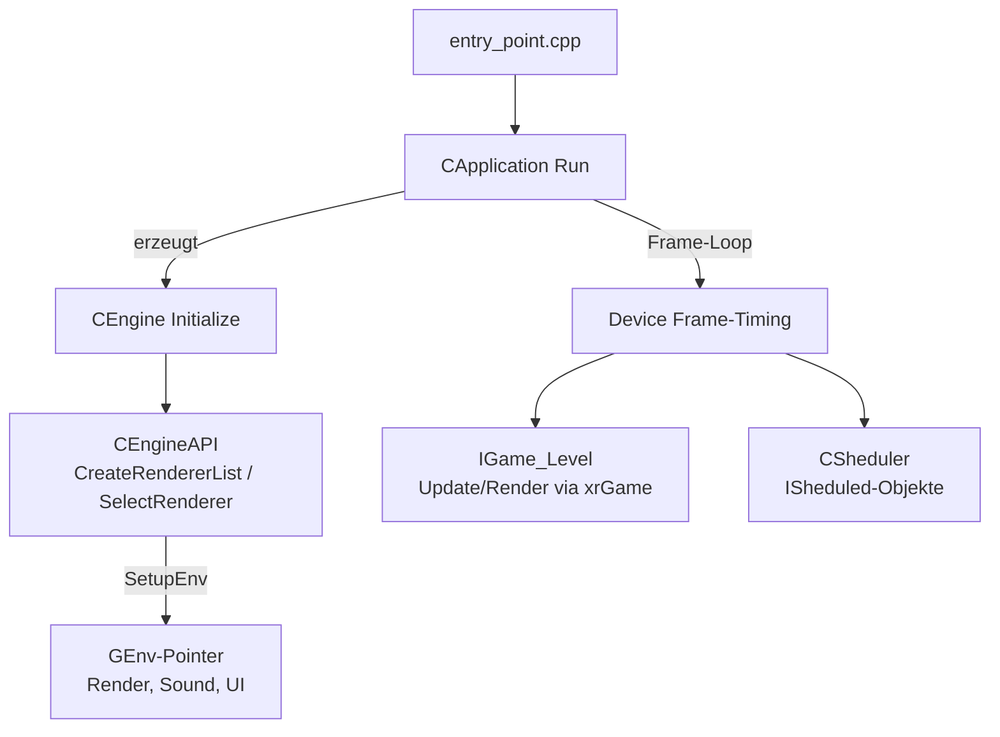
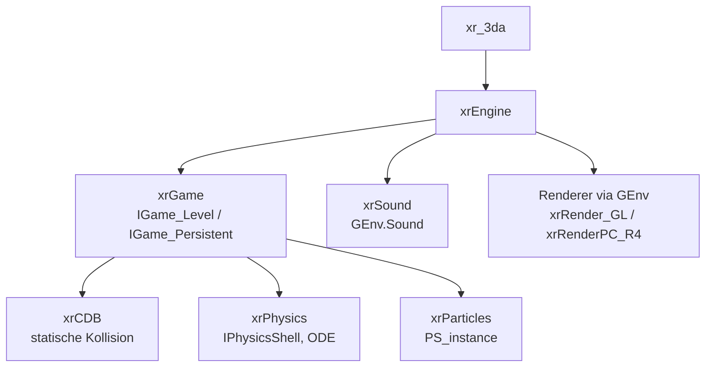

# Engine-Systeme: xrEngine, xrCDB, xrPhysics, xrParticles, xrSound, xr_3da

> Deutsche Entwickler-Dokumentation des OpenXRay/xray-16-Projekts (Engine-Kern).
> Pfade relativ zum Projekt-Stammverzeichnis. Fortsetzung: `docs/05-spiellogik.md` (xrGame).

## Einleitung

Die Engine-Systeme liegen zwischen Foundation und Spiellogik: App-Lebenszyklus (`xr_3da`), Haupt-Engine (`xrEngine`), Kollisionsdatenbank (`xrCDB`), Physik (`xrPhysics`), Partikel (`xrParticles`) und Audio (`xrSound`).

| Modul | Dateien (ca.) | Aufgabe |
|-------|---------------|---------|
| `src/xr_3da` | 4 | Programm-Einstiegspunkt |
| `src/xrEngine` | 153 | Game Loop, Device, Konsole, Input, Kamera, Environment, Scheduling |
| `src/xrCDB` | 23 | Collision Database, Spatial-Tree-Abfragen |
| `src/xrPhysics` | 157 | Physik-Simulation (ODE-Wrapper) |
| `src/xrParticles` | 16 | Partikel-Simulation |
| `src/xrSound` | ~40 | Audio über OpenAL |

---

## 1. `src/xr_3da` – Einstiegspunkt

`entry_point.cpp` implementiert die plattformspezifischen Einstiegspunkte und delegiert an `entry_point(pcstr commandLine)`:

```cpp
std::array<RendererModule*, 2> s_render_modules =
{
#ifdef XR_PLATFORM_WINDOWS
    xray::render::render_r4::GetRendererModule(), // DX11, nur Windows
#endif
    xray::render::render_gl::GetRendererModule(),  // OpenGL, immer
};

int entry_point(pcstr commandLine)
{
    tracy_raii raii; // sauberes Tracy-Shutdown
    auto* game = strstr(commandLine, "-nogame") ? nullptr : xrGameModuleInstance();
    CApplication app{ commandLine, game, s_render_modules };
    return app.Run();
}
```

- **Windows:** `WinMain()` mit eigenem Stack-Overflow-Filter (`__except` + `_resetstkoflw`, da BugTrap solche Ausnahmen nicht behandelt). Andere Plattformen nutzen klassisches `main()`.
- **GPU-Auswahl:** Exportiert `NvOptimusEnablement` (NVIDIA Optimus) und `AmdPowerXpressRequestHighPerformance` (AMD PowerXpress), damit Hybrid-Systeme die starke GPU nutzen.
- **`-nogame`:** startet die Engine ohne Spielmodul.
- **Tracy:** bei `-DXRAY_ENABLE_TRACY=ON` wird der Profiler beim Start initialisiert und beim Abbau heruntergefahren.

---

## 2. `src/xrEngine` – Haupt-Engine

### Zweck

`xrEngine` verwaltet Fenster/Gerät, Renderer-Initialisierung, Konsole, Input, Kameras, Umgebung/Wetter, Demo-Aufzeichnung, Objekt-Scheduling und die abstrakten Spiel-Schnittstellen (`IGame_Level`, `IGame_Persistent`), die von `xrGame` implementiert werden.

### Start & Kern

| Datei(en) | Aufgabe |
|-----------|---------|
| `x_ray.cpp/.h` | **`CApplication`**: SDL2-Fenster/Event-Loop, Discord Rich Presence, Crash-Handling; erhält Kommandozeile, Spielmodul und Renderer-Module |
| `Engine.cpp/.h` | **`CEngine`**: Initialisiert Subsysteme. Member (aus `Engine.h`): `CEngineAPI External`, `CEventAPI Event`, `CSheduler Sheduler`, `CSoundManager Sound` |
| `EngineAPI.cpp/.h` | **`CEngineAPI`**: Bibliotheks-Handling, Basisklasse `RendererModule`, `renderModes`-Map, `SelectRenderer()`, `CreateRendererList()`, Spielmodul-Factory (`Factory_Create`/`Factory_Destroy`) |
| `EventAPI.cpp/.h` | **`CEventAPI`**: globales Event-System |
| `device.cpp`, `Device_create/destroy/Initialize/mode/overdraw/imgui.cpp` | **Device**: zentrales Frame-/Fenster-Objekt (Initialisierung, Modi, Frame-Timing, Overdraw-Statistik, ImGui) |
| `Render.cpp/.h` | Kamera-/Frustum-Kontext für den Renderpfad |

### Konsole & Input

| Datei(en) | Aufgabe |
|-----------|---------|
| `XR_IOConsole.*` (`_callback`, `_control`, `_get`, `_script`) | Engine-Konsole: Befehle, Variablen, Autovervollständigung, Skript-Bindings |
| `xr_ioc_cmd.cpp/.h`, `Text_Console.*`, `Text_Console_WndProc.cpp` | eingebaute Befehle, On-Screen-Textkonsole |
| `edit_actions.*`, `line_edit_control.*` | Zeileneditor der Konsole (Cursor- und Lösch-Aktionen) |
| `xr_input.cpp/.h`, `IInputReceiver.*` | Input-Abstraktion (SDL2), Empfänger-Registrierung |
| `xr_level_controller.*`, `key_binding_registrator_script.cpp` | Level-Controller: Levelladen, Key-Bindings, Skript-Registrierung |

### Game-API-Schnittstellen (Implementierung: xrGame)

| Datei(en) | Aufgabe |
|-----------|---------|
| `IGame_Persistent.cpp/.h` | persistente Spielumgebung (Sitzung, Wetterwechsel) |
| `IGame_Level.cpp/.h`, `IGame_Level_check_textures.cpp` | Level-Schnittstelle: Objekte, Kamera, Spawning, Textur-Prüfung |
| `IGame_ObjectPool.*` | wiederverwendbarer Objekt-Pool |
| `xr_object.h`, `xr_object_list.*` | Objekt-Basis und -Verwaltung |
| `CustomHUD.*` | HUD-Schnittstelle |
| `StringTable/` | Lokalisierungstexte |

### Objekt-Rückruf-Interfaces

| Datei(en) | Aufgabe |
|-----------|---------|
| `pure.cpp/.h`, `pure_relcase.*` | Rückruf-Interfaces für Frame- und Lebenszyklus-Ereignisse |
| `ISheduled.*` | geplante Updates nach Priorität und Mindestrate |
| `IRenderable.*` | Render-Rückruf-Objekte |
| `ICollidable.*`, `xr_collide_form.*`, `cf_dynamic_mesh.*` | kollidierbare Objekte inkl. Kollisionsformen |
| `Feel_Touch.*`, `Feel_Vision.*`, `Feel_Sound.h` | Sensoren: Berührung, Sicht, Schall |
| `IPhysicsShell.h`, `IPhysicsGeometry.h`, `IObjectPhysicsCollision.h`, `IPHdebug.h` | Physik-Schnittstellen (Implementierung: `xrPhysics` bzw. `xrGame`) |
| `ILoadingScreen.h` | Ladebildschirm-Interface |

### Umgebung, Kamera & Effekte

| Datei(en) | Aufgabe |
|-----------|---------|
| `Environment.cpp/_editor/_misc/_render.cpp`, `Environment.h` | Wetter/Umgebung: Weather-Zyklen, Sonne, Himmel, Farbspektren |
| `CameraBase.*`, `CameraManager.*`, `CameraDefs.h` | Kamera-Basis und -Verwaltung |
| `Effector.*`, `EffectorPP.*` | Kamera- und Post-Processing-Effektoren |
| `Rain.*`, `thunderbolt.*`, `xr_efflensflare.*` | Regen, Blitz, Lens Flare |
| `LightAnimLibrary.*` | animierte Lichtfarben (LAnims) |
| `perlin.*`, `xrHemisphere.*` | Perlin-Noise, Hemisphären-Sampling |
| `ObjectAnimator.*`, `PS_instance.*` | animierte Kameraparameter, Partikel-Instanz (Bridge zum Renderer) |

### Demo, Diagnose, Editor & Medien

| Datei(en) | Aufgabe |
|-----------|---------|
| `FDemoPlay.*`, `FDemoRecord.*` | Demo-Aufzeichnung und -Wiedergabe |
| `profiler.*`, `Stats.*`, `StatGraph.*`, `PerformanceAlert.cpp` | CPU-Profiler, Statistiken, Warnungen |
| `ObjectDump.*`, `phdebug.cpp` | Objekt-Dumps, Physik-Debug |
| `editor_base.*`, `editor_base_input.cpp`, `editor_helper.*` | eingebetteter Editor-Modus |
| `GameFont.*` | Font-Rendering |
| `xrTheora_Stream.*`, `xrTheora_Surface.*`, `tntQAVI.*` | Theora-Videowiedergabe, AVI (Legacy) |
| `xrImage_Resampler.*` | Bild-Resampling |
| `mailSlot.cpp`, `defines.*`, `Properties.h`, `mp_logging.h` | IPC-Legacy, globale Definitionen, MP-Logging |
| `vis_common.h`, `vis_object_data.h`, `WaveForm.h`, `ShadersExternalData.h` | Shared-Daten für Sichtbarkeit und Shader |

### Lebenszyklus



---

## 3. `src/xrCDB` – Collision Database

Effiziente Abfragen auf statischer Level-Geometrie und räumlichen Strukturen. Genutzt von Physik, KI, Render-Okklusion und Spiellogik.

| Datei(en) | Aufgabe |
|-----------|---------|
| `xrCDB.cpp/.h` | Datenmodell der Collision DB (Modell-Builder, Triangle-Container) |
| `xrCDB_Collector.cpp` | Mesh-Collector (Vertex-/Triangle-Zusammenführung) |
| `xrCDB_box.cpp`, `xrCDB_ray.cpp`, `xrCDB_frustum.cpp` | Box-, Ray- und Frustum-Abfragen |
| `xrXRC.*` | Abfrage-/Ergebnis-Container (Wiederverwendung zwischen Frames) |
| `Frustum.*` | Frustum-Ebenen und Clipping |
| `ISpatial*.cpp/.h` | Spatial Tree: Registrierung, Box-/Frustum-/Ray-Queries |
| `xr_area.*`, `xr_area_query.cpp`, `xr_area_raypick.cpp` | räumliche Bereiche mit Abfragen |
| `xr_collide_defs.h` | Query-Flags und -Typen |

Die Level-Geometrie wird beim Laden in die DB überführt; alle Kollisions- und Sichtbarkeitsanfragen laufen danach über die indizierten Strukturen statt über rohe Meshes.

---

## 4. `src/xrPhysics` – Physik (ODE)

Wrapper und Spiel-Physik auf Basis von **ODE** (`Externals/ode`) und **OPCODE** (`Externals/OPCODE`, Triangle-Mesh-Kollision). Die CMake-Gruppen zeigen die interne Struktur:

| CMake-Gruppe | Aufgabe |
|--------------|---------|
| `Physics\Base\Objects\PHObject`, `PHIsland` | Simulationsobjekte und „Inseln“ (Gruppen simulierter Bodies) |
| `Physics\Base\Objects\Shell`, `BaseShell`, `SplitedShell`, `StaticShell` | **PhysicsShell**: Body-/Joint-Verschaltung eines Spielobjekts (auch geteilt/statisch) |
| `Physics\Base\Objects\Element` (+ `Geom`) | Elemente eines Shells mit Kollisionsgeometrien |
| `Physics\Base\Objects\Joint` | Gelenke zwischen Elementen |
| `Physics\Base\Objects\MoveStorage`, `utils\Interpolation` | Bewegungs- und Interpolationsspeicher |
| `Physics\Base\Objects\PHCommander` | Befehlswarteschlange für Physik-Aktionen |
| `Physics\Base\Objects\PHNet` | Netz-Synchronisation der Physik – kompiliert `../xrServerEntities/PHNetState.cpp` mit ein |
| `Physics\Base\Objects\Breakable`, `Damage receiver` | zerstörbare Objekte, Schadens-Schnittstelle |
| `Physics\Base\Objects\CollideValidator`, `Disabling` | Kollisions-/Ignore-Regeln, „Schlafenlegen“ von Bodies |
| `Physics\Base\Objects\PhyMove\*` | Charakterbewegung: `ActorCharacter`, `AICharacter`, `SimpleCharacter`, `Capture` (Greifen) |
| `Physics\Base\Objects\BodyEffectors` | Kraft-/Effekt-Objekte auf Bodies |
| `Physics\Base\Objects\World` | Physik-Welt (Gravitation, Zeitschritt, Iterationen) |
| `Physics\Base\Debug`, `Base\Impact` | Debug-Draw, Impact-Sammlung |
| `Physics\ActivationBox` | Aktivierungsfelder (schlafende Objekte wecken) |
| `Physics\Camera collision` | Kamera-Kollision gegen die Welt |
| `Physics\colliders\cyl`, `tri`, `RayMotions` | Collider-spezifische Tests |

`xrGame` erzeugt für physiktragende Objekte ein `IPhysicsShell` (Interface in `xrEngine/IPhysicsShell.h`); die Simulation läuft pro Frame in `xrPhysics`, statische Abfragen gehen über `xrCDB`, dynamische über die ODE-Welt. Die Netz-Synchronisation läuft über `PHNetState` (`xrServerEntities`).

---

## 5. `src/xrParticles` – Partikelsystem

Simulationsteil des Partikelsystems (die Render-Verwaltung liegt in `Layers/xrRender`: `PSLibrary`, `ParticleEffect*`).

| Datei(en) | Aufgabe |
|-----------|---------|
| `particle_core.*` | Basis-Partikel (Datenstruktur, Lebenszeit) |
| `particle_effect.*` | Effekt-Container (Emissions-Parameter) |
| `particle_manager.*` | Partikel-Manager (Update-Loop, Action-Pipeline) |
| `particle_actions.*` | Aktions-Basisklassen (Emission, Kräfte, Lebenszeit, Farbe) |
| `particle_actions_collection.*` + `_io.cpp` | konkrete Aktions-Bibliothek inkl. Serialisierung |
| `psystem.h` | Strukturdefinitionen |
| `noise.*` | Noise für Turbulenz |

Partikel-Definitionen werden beim Start über die `PSLibrary` des Renderers geladen (Interface: `Include/xrRender/particles_systems_library_interface.hpp`); Instanzen in der Engine sind `PS_instance`-Objekte (`xrEngine`).

---

## 6. `src/xrSound` – Audio (OpenAL)

Implementiert das Sound-Backend. Das Interface `ISoundManager` ist global via `GEnv.Sound` erreichbar; auf Engine-Seite hält `CEngine` den `CSoundManager` als Member (`CEngine::Sound`).

| Datei(en) | Aufgabe |
|-----------|---------|
| `Sound.cpp/.h` | `CSoundManager`-Implementierung (`ISoundManager`) |
| `SoundRender_Core.*`, `SoundRender_CoreA.*`, `_Processor.cpp`, `_StartStop.cpp`, `_SourceManager.cpp` | Kern der Audio-Verarbeitung (OpenAL-Variante „A“: Init, Listener, Update-Quelle) |
| `SoundRender_Emitter.*` + `_FSM.cpp` + `_StartStop.cpp` | Emitter mit Zustandsautomat (Stopped/Playing/…), Start/Stopp |
| `SoundRender_Source.*` | PCM-/OGG-Quellen (Laden, Wandlung) |
| `SoundRender_Scene.*` | Szenen-Verwaltung (aktive Sounds, Priorisierung) |
| `SoundRender_Environment.*`, `Effects.h`, `EffectsA_EAX.*` | Klangumgebung, Hall (EAX über OpenAL) |
| `SoundRender_Target.*`, `TargetA.*` | Ausgabekanäle (OpenAL-Sources) |
| `MusicStream.*` | Musik-Streaming (OGG) |
| `OpenALDeviceList.*` | Geräte-Enumeration |
| `xr_cda.*`, `xr_streamsnd.*`, `guids.cpp` | CD-Audio-Legacy, Streaming, Sound-GUIDs |

---

## Zusammenspiel & Abhängigkeiten



- Der Frame-Loop liegt in `CApplication`/Device; pro Frame werden geplante Objekte (`ISheduled`) aktualisiert, gerendert (`IRenderable`), Kollisionen (`xrCDB`, `xrPhysics`) und Sound (`xrSound`) verarbeitet.
- `xrGame` implementiert die abstrakten Schnittstellen aus `xrEngine` (`IGame_Level`, `IGame_Persistent`, `CustomHUD`, `IPhysicsShell`-Nutzer) und nutzt alle Engine-Systeme darüber.

## Hinweise für Entwickler & Modder

1. **Erweiterungen am Objekt-Verhalten** beginnen bei den `pure*`-/`ISheduled`-/`Feel_*`-Interfaces in `xrEngine` – nicht an der Frame-Schleife.
2. **Konsolenbefehle** in `xr_ioc_cmd.cpp` bzw. `XR_IOConsole_script.cpp` ergänzen (Skript-Bindings vorhanden).
3. **Physik-Zugriff** aus Spielcode immer über `IPhysicsShell`/`IPhysicsGeometry` – nie direkt auf ODE.
4. **Audio**: Alias-Definitionen (SND-Deskriptoren) liegen in den Spiel-Configs; Wiedergabe über `GEnv.Sound`.
5. **Diagnose**: `Stats`/`StatGraph`, `PerformanceAlert`, eigener `profiler.*`, optional Tracy (`ZoneScoped`).

---
*Basis: Verzeichnislisten von `src/xrEngine`, `src/xrCDB`, `src/xrParticles`, `src/xrSound`; CMake-Gruppen aus den jeweiligen `CMakeLists.txt`; `entry_point.cpp` (vollständig gelesen); `Engine.h`, `EngineAPI.h`, `x_ray.h` (Auszüge per Grep).*
