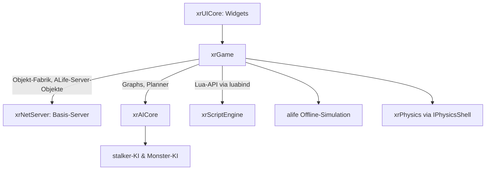

# Spiellogik: xrGame

> Deutsche Entwickler-Dokumentation des OpenXRay/xray-16-Projekts (Spielmodul).
> Pfade relativ zum Projekt-Stammverzeichnis. Verwandte Kapitel: `docs/04-engine-systeme.md`, `docs/07-netzwerk.md`.

## Einleitung

`src/xrGame` ist das **monolithische Spielmodul** (~2.350 Dateien) und damit das größte Modul des Projekts. Es enthält die komplette Spiellogik der S.T.A.L.K.E.R.-Reihe: Spieler (Actor), Waffen, Inventar, Artefakte, Anomalien, KI (Stalker, Monster, Tiere), die ALife-Offline-Simulation, Multiplayer (Client- und Server-Gamemodes), GameSpy-Integration, HUD-Anbindungen sowie die riesige Lua-Bindungsfläche.

Wichtige Aufteilung:

| Ordner | Inhalt |
|--------|--------|
| `src/xrGame/` (Top-Level) | ~600 Quelldateien: Actor, Waffen, Items, Level, Server, ALife, Skript-Bindings |
| `src/xrGame/ai/` | KI: `crow` (Krähen), `monsters` (Monster-KI), `phantom`, `stalker` (Stalker-KI), `trader` |
| `src/xrGame/ui/` | spielbezogene UI-Screens (Inventar, PDA, MP-Scoreboards – Widget-Bibliothek siehe `xrUICore`) |
| `src/xrGame/ik/` | Inverse Kinematik (Fuß-/Beinplatzierung) |
| `src/xrGame/gamespy/` | GameSpy-QR2-Callbacks |
| `src/xrGame/CdkeyDecode/` | CD-Key-Verarbeitung |
| `src/xrServerEntities/` | **Quellpool**: wird direkt in das `xrGame`-Target kompiliert (kein eigenes Target) |

---

## Modul-Registrierung und Start

| Datei | Aufgabe |
|-------|---------|
| `xrGame.cpp` | definiert das globale `xrGameModule xrGame`-Objekt (Fabrik für Client-/Server-Objekte: `xrFactory_Create()`/`xrFactory_Destroy()`) und registriert das Spielmodul bei der Engine (wird von `entry_point.cpp` als `xrGameModuleInstance()` bezogen) |
| `xrgame_dll_detach.cpp` | Aufräumarbeiten beim Entladen des Spielmoduls |
| `GameLevel.cpp` / `Level.cpp` | Implementierung der Engine-Schnittstelle `IGame_Level` (Update, Spawn, Render-Koordination); `Level.cpp` ist die zentrale Level-Klasse |

Das Spielmodul implementiert die abstrakten Engine-Schnittstellen aus `xrEngine`:

- `IGame_Persistent` → `GamePersistent.cpp` (Sitzung, Wetterwechsel, Ladebildschirm),
- `IGame_Level` → `Level.cpp` (+ `Level_load.cpp`, `Level_start.cpp`, `Level_SLS_Save/Load/Default.cpp`: Save/Load-Prozess vor Levelstart),
- `CustomHUD` → `HUDManager.cpp`.

---

## Spieler: Actor

Der Spieler ist die Klasse `CActor` (`Actor.cpp`, aufgeteilt in Aspekt-Dateien):

| Datei(en) | Aspekt |
|-----------|--------|
| `Actor.cpp`, `Actor_Events.cpp`, `Actor_Feel.cpp` | Lebenszyklus, Event-/Sensor-Verarbeitung |
| `Actor_Movement.cpp`, `ActorInput.cpp`, `actor_input_handler.cpp` | Bewegung, Input |
| `ActorCameras.cpp`, `ActorEffector.cpp` | Kameras, Effektoren |
| `ActorCondition.cpp`, `Actor_Sleep.cpp`, `ActorHelmet.cpp`, `ActorBackpack.cpp` | Zustand (Gesundheit, Ausdauer), Schlafen, Ausrüstung |
| `Actor_Weapon.cpp`, `ActorMountedWeapon.cpp`, `ActorVehicle.cpp` | Waffen-/Fahrzeugbedienung |
| `Actor_Network.cpp`, `actor_mp_client*.cpp`, `actor_mp_server*.cpp`, `actor_mp_state.cpp` | Netz-Anbindung inkl. Multiplayer-Sync-Zustand |
| `ActorFollowers.cpp` | Begleiter-Logik |
| `actor_script.cpp`, `ActorCondition_script.cpp` | Lua-Export |
| `detail_path_manager`-Nutzung via `PHMovementControl.cpp` | Bewegungs-/Physik-Kopplung |

Effektoren des Spielers: `EffectorBobbing.cpp` (Gehwackeln), `EffectorFall.cpp`, `EffectorShot.cpp`, `EffectorShotX.cpp`, `EffectorZoomInertion.cpp`, `SleepEffector.cpp` sowie `CameraFirstEye.cpp`/`CameraLook.cpp`/`spectator_camera_first_eye.cpp` (Kameratypen).

---

## Items, Waffen und Ausrüstung

### Waffen (`Weapon*.cpp`)

Basisklasse `Weapon.cpp`/`HudItem.cpp` plus pro Modell eigene Klassen: `WeaponAK74`, `WeaponFN2000`, `WeaponGroza`, `WeaponLR300`, `WeaponVal`, `WeaponVintorez`, `WeaponSVD`, `WeaponPM`, `WeaponHPSA`, `WeaponPistol`, `WeaponCustomPistol`, `WeaponRevolver`, `weaponBM16`, `WeaponShotgun`, `WeaponAutomaticShotgun`, `WeaponKnife`, `WeaponBinoculars` (+`WeaponBinocularsVision`), `WeaponRPG7`, `WeaponRG6`, `WeaponMagazined` (+`WeaponMagazinedWGrenade`), `WeaponStatMgun*` (stationäre MGs), `WeaponFire`, `WeaponDispersion`, `WeaponUpgrade`, `WeaponAmmo`, `WeaponScript`.

Anbauteile: `Silencer.cpp`, `Scope.cpp`, `GrenadeLauncher.cpp`, `RocketLauncher.cpp`/`CustomRocket.cpp`/`ExplosiveRocket.cpp`; Wurfgeschosse: `Grenade.cpp`, `Missile.cpp`, `Bolt.cpp` (Bolzen zum Testen).

### Inventar & Trade

`InventoryOwner.cpp` (Interface aller Inventarträger), `inventory_item.cpp`/`inventory_item_object.cpp` (Basis-Items), `inventory_quickswitch.cpp`, Upgrades: `inventory_upgrade*.cpp` (Base/Group/Manager/Property/Root), `attachable_item.cpp`/`attachment_owner.cpp` (Anbauteile-Verwaltung), Handel: `trade.cpp`/`trade2.cpp`/`trade_parameters.cpp`, `purchase_list.cpp` (MP-Kauflisten).

### Ausrüstung & Verbrauchsgegenstände

- Outfits: `CustomOutfit.cpp`, `StalkerOutfit`, `MilitaryOutfit`, `ScientificOutfit`, `ExoOutfit`.
- Verbrauch: `eatable_item.cpp`, `FoodItem.cpp`, `BottleItem.cpp`, `medkit.cpp`, `antirad.cpp`.
- Detektoren: `CustomDetector.cpp`, `SimpleDetector`/`AdvancedDetector`/`EliteDetector`.
- Sonstiges: `Torch.cpp` (Taschenlampe), `PDA.cpp`, `Artefact.cpp` + Artefakt-Varianten (u. a. `GraviArtifact`, `BlackGraviArtifact`, `BastArtifact`, `DummyArtifact`, `ThornArtifact`, `ZudaArtifact`, `MercuryBall`, `GalantineArtifact`, `FadedBall`, `RustyHairArtifact`, `artefact_activation.cpp`).

### Schadens- und Ballistiksystem

`Hit.cpp`/`hit_immunity.cpp` (Treffer-Datenstrukturen), `Wound.cpp`, `damage_manager.cpp`, `EntityCondition.cpp` (Gesundheitszustand), `BoneProtections.cpp`, `Level_Bullet_Manager.cpp` (+`Level_bullet_manager_firetrace.cpp`: Ballistik-Flugbahn), `Tracer.cpp` (Tracer-Rendering-Daten), `first_bullet_controller.cpp`, `fire_disp_controller.cpp` (Streuung).

---

## Level, Weltobjekte und Specials

| Datei(en) | Aufgabe |
|-----------|---------|
| `Level.cpp`, `Level_load.cpp`, `Level_start.cpp`, `level_script.cpp` | Level-Verwaltung, Ladevorgang, Skript-API |
| `Level_SLS_Save/Load/Default.cpp` | Server-Level-Save vor Levelstart (SLS = Server Level Save) |
| `LevelFogOfWar.cpp`, `level_map_locations.cpp`, `map_location.cpp`, `map_manager.cpp`, `map_spot.cpp` | Kartenaufdeckung, Map-Marker |
| `GameObject.cpp` | Basisklasse aller Spielobjekte (Schnittstelle zw. C++-Objekt und Skript) |
| `PhysicsShellHolder.cpp`, `PhysicObject.cpp`, `PhysicsSkeletonObject.cpp`, `DestroyablePhysicsObject.cpp`, `BreakableObject.cpp`, `PHSkeleton.cpp`, `PHShellCreator.cpp`, `physics_shell_animated.cpp`, `PHMovementControl.cpp`, `CharacterPhysicsSupport.cpp`, `PHCollisionDamageReceiver.cpp`, `PHDestroyable.cpp` | Physik-Brücken zu `xrPhysics` (Shells, zerstörbare Objekte, Charakter-Bewegung) |
| `Car.cpp` + `Car*.cpp` (Cameras, Damage, Doors, Exhaust, Input, Lights, Script, Sound, Weapon, Wheels) | Fahrzeuge; dazu `Helicopter.cpp`, `Helicopter2.cpp`, `HelicopterMovementManager.cpp`, `HelicopterWeapon.cpp` |
| `HangingLamp.cpp`, `searchlight.cpp`, `ClimableObject.cpp`, `doors_actor/door/manager.cpp`, `BreakableObject.cpp` | Weltobjekte: Lampen, Suchscheinwerfer, Kletterobjekte, Türen |
| `CustomZone.cpp` + Zonen-Implementierungen (`GraviZone`, `Mincer`, `MosquitoBald`, `NoGravityZone`, `RadioactiveZone`, `TorridZone`, `HairsZone`, `FryupZone`, `AmebaZone`, `ElectricBall`, `TeleWhirlwind`, `team_base_zone`, `ZoneCampfire`), `ZoneVisual.cpp`, `zone_effector.cpp`, `space_restrictor.cpp`, `script_zone.cpp` | Anomalien/Sonderräume; `space_restriction*.cpp` implementieren die Einschluss-/Ausschluss-Geometrie für Smart Terrains |
| `ParticlesObject.cpp`, `ParticlesPlayer.cpp`, `wallmark_manager.cpp`, `moving_objects*.cpp`, `DynamicHeightMap.cpp`, `traffic_optimization.cpp`, `restricted_object*.cpp`, `obstacles_query.cpp`, `steering_behaviour.cpp` | Partikel, Decals, dynamische Hindernisse, Restriktionen |

---

## KI: Stalker, Monster, Agenten

### `ai/`-Unterordner

| Ordner | Inhalt |
|--------|--------|
| `ai/stalker` | Kern der Stalker-KI (9 .cpp) – die Verhaltenslogik liegt größtenteils in den Top-Level-`stalker_*.cpp` |
| `ai/monsters` | Monster-KI (136 .cpp), sortiert nach Gegnertyp: `basemonster`, `bloodsucker`, `boar`, `burer`, `cat`, `chimera`, `controller`, `dog`, `flesh`, `fracture`, `poltergeist`, `pseudodog`, `pseudogigant`, `rats`, `snork`, `tushkano`, `zombie` + übergreifende `states`/`group_states` |
| `ai/crow` | Krähen-Verhalten |
| `ai/phantom` | Phantom-Anomalien |
| `ai/trader` | Händler-KI |

### Stalker-Verhalten (Top-Level `stalker_*.cpp`)

Deutlichste Struktur: **Planer** („Action Planners“, Prioritäten-Baum) je Situation:

- `stalker_planner.cpp` (Hauptplaner) + Planner je Task: `stalker_alife_planner`, `stalker_combat_planner`, `stalker_danger_planner` (+ Unterplaner: `danger_by_sound`, `danger_grenade`, `danger_in_direction`, `danger_unknown`), `stalker_death_planner`, `stalker_get_distance_planner`, `stalker_kill_wounded_planner`, `stalker_low_cover_planner`, `stalker_search_planner`, `stalker_anomaly_planner`.
- Jeweils passende `*_actions.cpp`-Dateien und `stalker_property_evaluators.cpp` (Bedingungen).

**Animation:** `stalker_animation_manager.cpp` (+ `_update`, `_debug`) mit Schichten `legs`/`torso`/`head`/`global`, `stalker_animation_pair`, `stalker_animation_script`, `stalker_animation_names`, `stalker_animation_data(_storage)`, `stalker_animation_offsets`, `stalker_animation_callbacks`, `stalker_animation_state`.

**Bewegung:** `stalker_movement_manager_base/obstacles(_path)/smart_cover(_fov_range/_loopholes)`, `stalker_movement_params`, `stalker_velocity_collection/
holder`.

**Sonstiges:** `stalker_sound_data(_visitor)`, `stalker_base_action`, `CustomMonster.cpp`, `CustomMonster_VCPU.cpp` (Ausführung in Update-Threads).

### Agenten- und Gruppenverhalten

`agent_manager.cpp` (+ `_planner`, `_actions`, `_properties`, `_memory_manager`) mit Einzeldiensten: `agent_corpse_manager`, `agent_enemy_manager`, `agent_explosive_manager`, `agent_location_manager`, `agent_member_manager`, `agent_memory_manager`; dazu `group/squad/team_hierarchy_holder.cpp` (Hierarchie) und `seniority_hierarchy_holder.cpp`.

### Gefahr, Deckung, Erinnerung

- **Gefahr:** `danger_manager`, `danger_object(_location)`, `danger_cover_location`, `danger_explosive`.
- **Deckung:** `cover_manager`, `cover_evaluators`, `cover_point_script`; **Smart Covers** (Deckungsobjekte mit Verhaltensregeln, aus CoP): `smart_cover.cpp` + Familie (`description`, `detail`, `loophole`, `storage`, `object`, `transition(_animation)`, `animation_planner/_selector`, `evaluators`, `planner_actions/_target_provider/_target_selector`, `default_behaviour_planner`).
- **Erinnerung:** `memory_manager`, `visual_memory_manager(-_params)`, `sound_memory_manager`, `hit_memory_manager`, `enemy_manager`, `vision_client`; `actor_memory`/`car_memory`.
- **Bewegung allgemein:** `movement_manager(_game/_level/_patrol/_physic)`, `detail_path_manager(_smooth)`, `patrol_path_manager`, `sight_manager(-_target)`, `sight_action`, `restricted_object(-_obstacle)`, `obstacles_query`, `moving_object(s)` + Kollision (`_dynamic_collision`), `dynamic/static_obstacles_avoider`, `steering_behaviour`, `min_obb`, `trajectories`, `magic_box3`, `magic_minimize_1d`.

### Inverse Kinematik (`ik/` und `ik_*.cpp`)

`IKLimbsController`, `IKFoot`, `ik_foot_collider`, `ik_calculate_data`, `ik_anim_state`, `ik_dbg_matrix`: Fußplatzierung auf unebenem Grund für Stalker/Monster/Actor.

---

## ALife – die Offline-Simulation

`alife_*.cpp` implementiert die persistente Welt-Simulation abseits des Spielers (Spawn, Offline-Switches, Ökonomie):

- Kern: `alife_simulator.cpp` (`CALifeSimulator`), `alife_simulator_base.cpp` (+ `base2`), `alife_simulator_header`, `alife_simulator_script`.
- Objekte: `alife_object.cpp`, `alife_creature_abstract`, `alife_human_abstract`, `alife_monster_abstract/_base`, `alife_trader(_abstract)`, `alife_group_abstract`, `alife_dynamic_object`, `alife_smart_zone`, `alife_anomalous_zone`.
- Registries: `alife_object_registry`, `alife_spawn_registry` (+ `_header`, `_spawn`), `alife_graph_registry`, `alife_group_registry`, `alife_story_registry`, `alife_schedule_registry`, `alife_smart_terrain_registry`, `alife_registry_container`.
- Manager: `alife_time_manager`, `alife_update_manager`, `alife_storage_manager`, `alife_switch_manager` (online/offline), `alife_surge_manager` (Ausstoß-Wellen), `alife_combat_manager`, `alife_communication_manager`, `alife_interaction_manager`.
- Smart Terrain (KI-Level-Aufenthaltsstruktur): `alife_smart_terrain_task(-_script)`, `alife_online_offline_group(_brain)`.

---

## Multiplayer

### Server (`xrServer_*.cpp`, Logik im Spielmodul)

`xrServer.cpp` + Aspekt-Dateien: `xrServer_Connect/Disconnect`, `xrServer_CL_connect`/`_CL_disconnect` (Client-Lifezyklus), `xrServer_perform_sls_save/load/default/clear` (Level-Server-Saves), `xrServer_process_spawn`, `xrServer_process_update`, `xrServer_process_event*` (activate/destroy/ownership/reject), `xrServer_perform_GameExport`, `xrServer_perform_migration`, `xrServer_perform_RPgen` (Respawn-Points), `xrServer_perform_transfer`, `xrServer_updates_compressor`, `xrServer_MapSync`, `xrServer_secure_messaging`, `xrServer_svclient_validation`, `xrServer_balance`, `xrServer_info`, `xrClientsPool`.

Gamemodes: `game_sv_base.cpp` (+ `_script`, `_console_vars`) und Varianten `game_sv_single` (Singleplayer!), `game_sv_deathmatch`, `game_sv_teamdeathmatch`, `game_sv_artefacthunt`, `game_sv_capture_the_artefact` (+ jeweils `_process_event`-Dateien), `game_sv_mp` (+ `_script`), `game_sv_item_respawner`, `game_sv_event_queue`.

### Client

`game_cl_base.cpp` (+ `_script`, `_mp`) mit UI-Varianten `game_cl_single`, `game_cl_deathmatch`, `game_cl_teamdeathmatch`, `game_cl_artefacthunt`, `game_cl_capture_the_artefact`; Netz-Aspekt in `Level_network*.cpp`: `Level_network.cpp`, `Level_network_messages.cpp`, `Level_network_spawn.cpp`, `Level_network_start_client.cpp`, `Level_network_compressed_updates.cpp`, `Level_network_map_sync.cpp`, `Level_network_Demo.cpp`, `Level_secure_messaging.cpp`, `Level_network_digest_computer.cpp`, `Message_Filter.cpp`, `file_transfer.cpp`, `filereceiver_node.cpp`, `DemoInfo.cpp` (+ `_Loader`), `DemoPLay_Control.cpp`, `configs_dumper.cpp`/`configs_dump_verifyer.cpp` (Anti-Cheatconfig-Dumps!), `screenshot_server.cpp` (Screenshot-Verifikation), `secure_messaging.cpp` (abgesicherter Austausch), `xrGameSpyServer.cpp` (Master-Server-Connector).

### Konten & GameSpy-Integration

`account_manager(.cpp/_console/_script)`, `player_account.cpp`, `login_manager.cpp`, `profile_store.cpp`, `cdkey_ban_list.cpp`, `CdkeyDecode`, `xrGameSpy_GameSpyFuncs.cpp`, `gamespy/GameSpy_QR2_callbacks.cpp`, `xrGameSpyServer_callbacks.cpp` – Verwaltung über die GameSpy-SDK-Basis (Details Kapitel 07).

---

## HUD & spielbezogene UI

`HUDManager.cpp`/`HUDCrosshair`/`HUDTarget`/`HitMarker.cpp`/`UIGame{Custom,SP,MP,DM,TDM,AHunt,CTA}.cpp`; Spieler-HUD (waffe in Hand): `player_hud.cpp` (+ `_tune`), `HudItem.cpp`, `hud_item_object.cpp`, `HudSound.cpp`. Dialog-/Screen-Verwaltung: `UIDialogHolder.cpp`, `UIMainMenu` (xrGame/ui, 138 .cpp), `ScriptXMLInit.cpp` (UI aus XML-Layouts für Skripte), `UIPanelsClassFactory.cpp` (MP-Scoreboard-Panels `UITeam*`). Widget-Bibliothek selbst: Kapitel `docs/06-scripting-ui-ki.md` (`xrUICore`).

---

## Skript-Bindings (Lua-API)

Auffälligstes Merkmal von `xrGame`: ** hunderte `*_script.cpp`-Dateien** (z. B. `actor_script.cpp`, `script_game_object*.cpp`, `trade`-Export, `PhraseDialog_script.cpp`, Zone-/Waffen-/Effector-Exports). Darunter klassenlogik-lose Wrapper (`script_*_wrapper.cpp` für eigene Skript-Klassen: Aktionen, Planner, Property-Evaluatoren, Effektoren, Binder). Die Bindings nutzen **luabind** (de-boostified, `Externals/luabind`) über **LuaJIT** (`Externals/LuaJIT`); die Skript-Engine steht in `src/xrScriptEngine` (Kapitel 06). Skripte selbst liegen im Spiel unter `$game_scripts$`.

---

## Zusammenspiel & Abhängigkeiten

## Hinweise für Entwickler & Modder

1. **Einstieg lesen:** `xrGame.cpp` → `GameObject.cpp` → `Actor.cpp` → `Level.cpp`.
2. **Verhalten erweitern:** neue Planer-Aktionen in `stalker_*`-Familie ergänzen (Muster: actions/property_evaluators).
3. **Lua-API:** neue Klassen immer mit `*_script.cpp`-Export koppeln (Muster vorhanden).
4. **MP-Änderungen:** immer alle `game_sv_*`/`game_cl_*`-Paare beachten (Serverlogik/Client-UI).

---
*Basis: vollständige Top-Level-Dateiliste `src/xrGame` (find), Unterordnerlisten, `xrGame/CMakeLists.txt` (Quellliste inkl. `../xrServerEntities/*`), Dateinamen semantisch gruppiert.*
