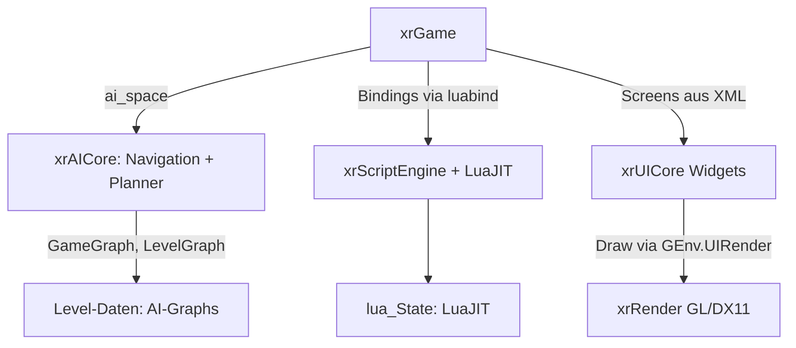

# Scripting, UI und KI-Kern: xrScriptEngine, xrUICore, xrAICore

> Deutsche Entwickler-Dokumentation des OpenXRay/xray-16-Projekts.
> Pfade relativ zum Projekt-Stammverzeichnis. Verwandt: `docs/05-spiellogik.md` (Nutzungsseite der Lua-API).

## Einleitung

Drei spezialisierte Bibliotheken unterstützen das Spielmodul: die **Skript-Engine** (Lua über LuaJIT + luabind), die **UI-Widget-Bibliothek** und der **KI-Kern** (Navigation + Planer-Komponenten). Alle drei werden über die globale Umgebung `GEnv` (`ScriptEngine`, `UI`, `AISpace`) bzw. direkt von `xrGame` genutzt.

| Modul | Umfang | Aufgabe |
|-------|--------|---------|
| `src/xrScriptEngine` | 16 Dateien | Lua-Skripting: Engine, Prozesse, Debugger, Profiler |
| `src/xrUICore` | ~118 Dateien (57 .cpp) | Widget-Bibliothek für alle Screens |
| `src/xrAICore` | 94 Dateien | Graphen, Pfadfindung, Planer-Komponenten |

---

## 1. `src/xrScriptEngine` – Lua-Engine

### Zweck

Bereitstellung und Verwaltung der **Lua**-Laufzeit (Lua 5.1-API, standardmäßig via **LuaJIT**, `Externals/LuaJIT`) und der C++-Bindungen (**luabind-deboostified**, `Externals/luabind`). Global erreichbar als `GEnv.ScriptEngine` (Typ `CScriptEngine*`, deklariert in `Include/xrAPI/xrAPI.h`). Die Spiel-Skripte liegen in der Spielinstallation unter `$game_scripts$`.

### Dateien

| Datei | Aufgabe |
|-------|---------|
| `xrScriptEngine.cpp`, `script_engine.cpp/.h` | **`CScriptEngine`**: Lua-States, globales Environment, Skript-Laden/Neuladen |
| `script_process.cpp` | `CScriptProcess`: laufende Skript-Module mit Update-Takt |
| `script_thread.cpp` | „Threads“ der Skripte (Koroutinen-artige Verarbeitung) |
| `script_lua_helper.*`? | low-level Lua-Hilfen (`lua_State`-Verwaltung, gepushte Funktoren) |
| `script_stack_tracker.cpp`(+`mslotutils.h`) | Stack-Tracking (Debug-Infos bei Skriptfehlern) |
| `script_debugger.cpp`, `script_debugger_threads.cpp` | eingebauter Skript-Debugger |
| `script_profiler.cpp` | Lua-Profiler |
| `script_callback_ex.h` | typsichere Callback-Vorlagen (`script_callback_ex`) |
| `ScriptExporter.cpp` | zentrale Export-Routine für luabind-Klassen |
| `ScriptEngineScript.cpp` | exportiert Skript-Engine-Funktionen selbst nach Lua |
| `BindingsDumper.cpp` | schreibt alle Bindings in eine Datei (API-Referenz!) |
| `script_callStack.cpp`, `pch.cpp` | Aufruf-Stack der Skripte, Precompiled Header |

> Die eigentlichen Bindings (hunderte `*_script.cpp`) verteilen sich über `xrGame` und `xrServerEntities` – siehe `docs/05-spiellogik.md` bzw. `docs/07-netzwerk.md`.

---

## 2. `src/xrUICore` – Widget-Bibliothek

### Zweck

Basis-Widget-Bibliothek für **alle** UI-Screens (Menü, Inventar, PDA, Dialoge, MP-Scoreboards). Global erreichbar als `GEnv.UI` (Typ `UICore*`); die spielbezogenen Screens liegen in `src/xrGame/ui` (138 .cpp) und nutzen diese Bausteine.

### Baukasten (Unterordner)

| Unterordner | Inhalt |
|-------------|--------|
| `Windows/` | `CUIWindow`-Hierarchie (Basisfenster, die Eltern-Kind- sowie Event-Fokusverwaltung) |
| `Buttons/` | Buttons, Check-Buttons,.radioButton etc. |
| `Static/` | Text-/Bild-Statikelemente |
| `EditBox/`, `SpinBox/`, `ComboBox/` | Eingabefelder und Auswahllisten |
| `ListBox/`, `ListWnd/`, `ScrollView/` | Listen-/Scroll-Container |
| `ScrollBar/`, `TrackBar/` | Laufleisten, Slider |
| `TabControl/`, `PropertiesBox/`, `Options/` | Reiter, Eigenschaftenlisten, Optionsseiten |
| `MessageBox/`, `Hint/` | Dialogboxen, Hinweisblasen |
| `ProgressBar/` | Fortschrittsbalken |
| `Lines/` | mehrzeilige Textverarbeitung |
| `FontManager/` | Font-Verwaltung |
| `Cursor/`, `arrow/` | Mauszeiger, Kompass-/Radar-Pfeil |
| `Callbacks/` | UI-Callback-System |
| `InteractiveBackground/` | interaktive Hintergründe (Slider-artige Bedienelemente) |
| `XML/` | XML-Parser der UI-Layouts (Screens werden aus `.xml`-Dateien aufgebaut) |

Arbeitsweise: Jeder Screen wird über `XML`-Deskriptoren instanziiert, Events laufen über die `Windows`-Hierarchie, Skript-Bindings regeln die Interaktion mit `xrGame` (Muster: `UIDialogHolder`, `ScriptXMLInit`). Das Rendering wird über `GEnv.UIRender` (Schnittstelle aus `Include/xrRender/UIRender.h`, Implementierung `dxUIRender` in `Layers/xrRender`) erledigt.

---

## 3. `src/xrAICore` – KI-Kern (Hyperbibliothek)

### Zweck

Backend-agnostische KI-Grundlagen: **Navigationsgraphen** des Spiels und **Planer-Komponenten** (GOAP-artig). Wird von `xrGame` über das `AISpaceBase`-Interface (`GEnv.AISpace`) integriert (Game-seitiger Einstieg: `xrGame/ai_space.cpp`).

### Ordnerstruktur

```
src/xrAICore/
├── Kernel/                    (Kernobjekte des KI-Systems)
├── Components/
│   └── ProblemSolver/         (Planer: Weltzustände + Operatoren)
│       ├── ConditionState/    (+ ScriptWorldState)
│       ├── OperatorAbstract/
│       └── OperatorCondition/ (+ ScriptWorldProperty)
└── Navigation/
    ├── GameGraph/             (globaler Graph über alle Levels)
    ├── GameLevelCrossTable/   (Übergabetabelle Levelgraph ↔ GameGraph)
    ├── LevelGraph/            (Level-Graph, Zellenstruktur)
    ├── GraphAbstract/         (generische Graph-Container)
    ├── ObjectLocation/        (Objektposition in den Graphen)
    ├── PatrolPath/            (Params, PatrolPoint, Storage: Patrouillenwege)
    └── Pathfinding/
        ├── Algorithms/ (AStar, Dijkstra)
        ├── DataStorages/ (Constructors, PathBuilders,
        │                   PriorityQueues, VertexAllocators,
        │                   VertexManagers)
        ├── GraphEngine/ (zentrale Suchmaschine)
        └── PathManagers/ (Game, Generic, Level, Params, Solver)
```

### Bausteine

- **LevelGraph**: Zellenraster des Levels für lokale Wegfindung; **GameGraph**: weltübergreifender Graph (Level-Übergänge); **CrossTable**: Zuordnung Levelzelle ↔ Gameknoten.
- **GraphEngine & PathManagers**: eigentliche Suche (A* / Dijkstra) über generische Data-Storages (Vertex-Manager/Allocator, Priority-Queues) – dadurch für Level- wie Game-Pfade wiederverwendbar.
- **ProblemSolver**: Planungs-Komponente: Zustände (`ConditionState`/`ScriptWorldState`) + Operatoren (`OperatorAbstract`, `OperatorCondition`/`ScriptWorldProperty`) – Basis der Action-Planner in `xrGame` (stalker-/monsters-Verhalten, Smart-Cover-Planner).
- **PatrolPath**: Patrouillenwege (aus Spiel-Configs), die Verhaltensskripte referenzieren.

---

## Zusammenspiel & Abhängigkeiten



## Hinweise für Entwickler & Modder

1. **UI-Änderungen:** Layout bevorzugt in XML anpassen (Spiel-`configs/ui/`), nicht im C++-Widget-Code.
2. **Lua-API erweitern:** Muster aus beliebiger `*_script.cpp` in `xrGame` kopieren; Export über `ScriptExporter`.
3. **Bindings-Dump:** `BindingsDumper` liefert eine vollständige API-Liste (nützlich als Referenz).
4. **Planer (GOAP):** Neue Verhalten über `ProblemSolver`-Operatoren kombinieren; Bedingungen in `stalker_property_evaluators` als Muster.

---
*Basis: Dateilisten (`find`) und CMake-Gruppen von `xrScriptEngine`, `xrUICore`, `xrAICore`; `Include/xrAPI/xrAPI.h` (`GEnv`: `ScriptEngine`, `UI`, `AISpace`).*
