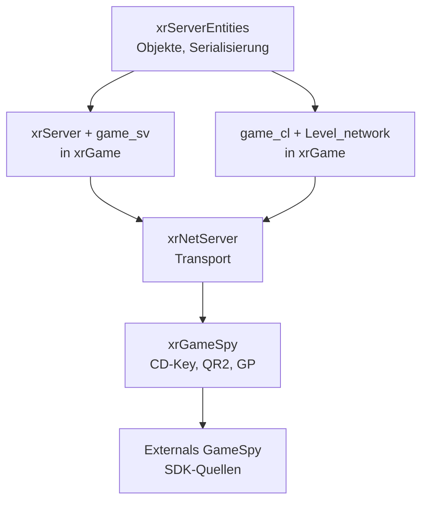

# Netzwerk & Multiplayer: xrNetServer, xrServerEntities, xrGameSpy

> Deutsche Entwickler-Dokumentation des OpenXRay/xray-16-Projekts (Netzwerkschicht).
> Pfade relativ zum Projekt-Stammverzeichnis. Die MP-Spiellogik selbst liegt in `xrGame` – siehe `docs/05-spiellogik.md`.

## Einleitung

Die Netzwerk-Funktionen verteilen sich auf vier Ebenen:

1. **`src/xrNetServer`** – Transport-Schicht (Sockets, Pakete, Kompression),
2. **`src/xrServerEntities`** – geteilte Datenstrukturen (Server-Objekte, Serialisierung, Fabriken) – **Quellpool ohne eigenes Target**, kompiliert in `xrGame` (Ausnahme: `PHNetState.cpp` landet in `xrPhysics`),
3. **`src/xrGameSpy`** – Integration der GameSpy-SDK (`Externals/GameSpy`): Master-Server, CD-Keys, Server-Browser, Accounts,
4. **`xrGame`** – die eigentlichen Server-/Client-Klassen (`xrServer*`, `game_sv_*`, `game_cl_*`, `Level_network*`).

---

## 1. `src/xrNetServer` – Transport-Schicht

| Datei | Aufgabe |
|-------|---------|
| `NET_Server.h/.cpp`, `NET_Client.h/.cpp` | Basisklassen `IPureServer`/`IPureClient`: UDP-Transport, Verbindungen, Zuverlässigkeits-Slots |
| `NET_Common.h/.cpp` | gemeinsame Typen (Puffer, Zeitstempel) |
| `NET_Messages.h` | Message-IDs/-Konstanten des Protokolls |
| `NET_Compressor.h/.cpp` | Kompression der Pakete (LZO-Schema) |
| `NET_AuthCheck.h/.cpp` | Authentifizierungs-Prüfung |
| `NET_Log.h/.cpp` | Netz-Logging (MP-Debug) |
| `NET_PlayersMonitor.h` | Überwachung/Bestandsverwaltung verbundener Spieler |
| `NET_Shared.h` | gemeinsam genutzte Definitionen |
| `ip_filter.h/.cpp` | IP-Sperrlisten (Bans) |
| `guids.cpp` | GUIDs für Netz-Objekte |

Die Transportschicht kennt keine konkreten Spielobjekte: Sie stellt Verbindungen, Paket-Zuverlässigkeit und Kompression bereit. Das eigentliche Protokoll (Nachrichten-IDs) definieren `NET_Messages.h` (Transport) und `xrMessages.h` (Objektebene, `xrServerEntities`).

---

## 2. `src/xrServerEntities` – geteilte Server-Daten (Quellpool, 112 Dateien)

Kein eigenes CMake-Target! Die Dateien werden (per `xrGame/CMakeLists.txt`) direkt in das `xrGame`-Target kompiliert; `PHNetState.cpp` zusätzlich in `xrPhysics`.

### Bestandteile

| Datei-Bereich | Aufgabe |
|---------------|---------|
| `xrServer_Object_Base.*`, `xrServer_Objects.*`, `xrServer_Objects_Abstract.*` | Basisklassen aller serverseitigen Objekte |
| `xrServer_Objects_ALife.*`, `…_ALife_Items.*`, `…_ALife_Monsters.*`, `…_ALife_Smartcovers.*` | ALife-Server-Objekte (persistente Weltobjekte, Inventargegenstände, Monster, Deckungen) |
| `object_factory*.cpp/.h` | **Objekt-Fabrik** (Klassen-ID → C++ oder Skriptklasse), inkl. `object_factory_script.cpp` |
| `smart_cast.*` (+ `_impl0/1/2.h`, `_stats.cpp`) | `smart_cast`-Infrastruktur (typsichere Querscasts über die Klassenhierarchie) |
| `xrServer_Factory.cpp` | Server-Factory |
| `PHNetState.h/.cpp`, `PHSynchronize.h` | Netz-Synchronisation der Physik |
| `xrMessages.h` | Message-IDs (in `xrEngine` registriert) |
| `alife_human_brain.*`, `alife_monster_brain.*` | ALife-„Gehirne“ (Verhalten offline simulierter Kreaturen) |
| `character_info*.*`, `specific_character.*` | Charakterdaten (Name, Rang, Community, Reputation) |
| `script_*_script.cpp`, `script_ini_file.*`, `script_value*.*` | Lua-Bindings der Basis-Typen (Fmatrix, Fvector, Fcolor, Flags, INI-Reader, Token-Listen, Properties-Lists) |
| `clsid_game.h`, `game_base_space.h`, `gametype_chooser.*` | Spielklassen-IDs, Gametype-Definitionen |
| `restriction_space.h`, `inventory_space.h`, `InfoPortionDefs.h`, `ItemListTypes.h`, `ai_sounds.h`, `alife_space.*`, `alife_movement_manager_holder.h` | gemeinsame Konstanten/Struktur-Definitionen für Spiel und Server |
| `xrEProps.h`, `xml_str_id_loader.h`, `ShapeData.h`, `shared_data.h`, `PropertiesListHelper.h`/`ListTypes.h` | Editor-/Tool-Bindungen und geteilte Datenbehälter |

`xrServerEntities` ist damit der **Vertrag zwischen Client und Server**: Serialisierung, Objekt-Identitäten und das Nachrichtenformat, die beide Seiten verwenden.

---

## 3. `src/xrGameSpy` – GameSpy-Integration (26 Dateien)

Wrapper um die GameSpy-SDK (`Externals/GameSpy`, Submodule). Die klassische Online-Infrastruktur (Master-Server-Listen, CD-Key-Prüfung, Accounts) stammt hieraus.

| Datei | Aufgabe |
|-------|---------|
| `xrGameSpy.cpp/.h`, `xrGameSpy_MainDefs.h` | Kapselung/Zentrale |
| `GameSpy_QR2.*` | QR2: Server-Reporting/Listung an Master-Server |
| `GameSpy_GCD_Client.*`/`Server.*` | GCD: CD-Key-Prüfung (GameSpy CD-Key-SDK) |
| `GameSpy_GP.*` | GP: Player-Accounts (Profile) |
| `GameSpy_ATLAS.*` | ATLAS: Statistik/Bestenlisten-SDK |
| `GameSpy_Browser.*`, `GameSpy_BrowsersWrapper.*` | Server-Browser (Anzeige/Direktverbindung) |
| `GameSpy_HTTP.*` | HTTP-Transfers der SDK |
| `GameSpy_Available.*` | Verfügbarkeit der GameSpy-Dienste prüfen |
| `GameSpy_Full.*`, `GameSpy_Keys.h` | Voll-Initialisierung bzw. Schlüsseldefinitionen |
| `stdafx.*` | Präcompilierte Header |

Spielbezogene Nutzung: `xrGame/xrGameSpyServer.cpp` (dedizierter/Omni-Server im Master-Register), `xrGame/xrGameSpy_GameSpyFuncs.cpp`, `xrGame/xrGameSpyServer_callbacks.cpp`, `xrGame/gamespy/GameSpy_QR2_callbacks.cpp`, `xrGame/CdkeyDecode/`, `login_manager`, `profile_store` – die übrige Kontenverwaltung (`account_manager`, `login_manager`, `profile_store`) liegt in `xrGame`.

> **Historischer Kontext:** Die GameSpy-Onlinedienste wurden 2014 abgeschaltet; die Server-Anmeldung über die Originaldienste ist daher heute nicht mehr funktionsfähig. Die Integration bleibt (u. a. für LAN, Direct-IP und Kompatibilität) im Code.

---

## 4. Multiplayer-Architektur (Implementierung in `xrGame`)

- **Server:** `xrServer*` (Verbindungen, Spawning, Events, Welt-Updates) pro Spielmodus (`game_sv_base` → `game_sv_single`, `game_sv_mp` → `DM/TDM/ArtefactHunt/CTA`). Dedizierter Betrieb wird über `GEnv.isDedicatedServer` erkannt (Header `Include/xrAPI/xrAPI.h`) und per Start-Option aktiviert.
- **Client:** `game_cl_*`-Klassen, `Level_network*`-Dateien (Verbinden, Spawn, Nachrichten, Update-Dekompression), `actor_mp_*` (Playerzustands-Sync).
- **Anti-Cheat:** `configs_dumper.cpp` + `configs_dump_verifyer.cpp` (Vergleich der Spieler-Configs), `screenshot_server.cpp` (Screenshot-Anforderung), `secure_messaging` (verschlüsselte Kontrollnachrichten), `Level_network_digest_computer.cpp` (Digests).
- **File-Transfer:** `file_transfer.cpp`, `filereceiver_node.cpp` (Überspielen von Savegame-/Mapdateien).
- **Demos:** `DemoInfo.cpp`, `Level_network_Demo.cpp`, `DemoPLay_Control.cpp` (MP-Demos aufzeichnen/wiedergeben).

## Hinweise für Entwickler & Modder

1. **Protokoll ändern** heißt: `NET_Messages.h` (IDs), `xrMessages.h` (Objektebene) und die `process_event`-Dateien konsistent halten.
2. **New Server-Objekte:** über `object_factory` registrieren (C++ oder Skriptklasse) und in `xrServer_Objects_*` serialisieren.
3. **Debugging:** `NET_Log.cpp` und `mp_logging.h` nutzen; Server-Konsolenvariablen liegen in `xrGame/game_sv_base_console_vars.cpp`.
4. **GameSpy ausblenden:** Build bleibt ohne die Onlinedienste funktionsfähig (LAN/Direct-IP); dies beachten, wenn Änderungen an `login_manager`/`profile_store` geplant sind.

---
*Basis: Dateilisten `find`, `xrGame/CMakeLists.txt` (Einbindung von `../xrServerEntities/*`), `xrNetServer/CMakeLists.txt`, `Include/xrAPI/xrAPI.h` (`isDedicatedServer`), `xrGameSpy/CMakeLists.txt` (Include-Pfade `Externals/GameSpy/src`).*
