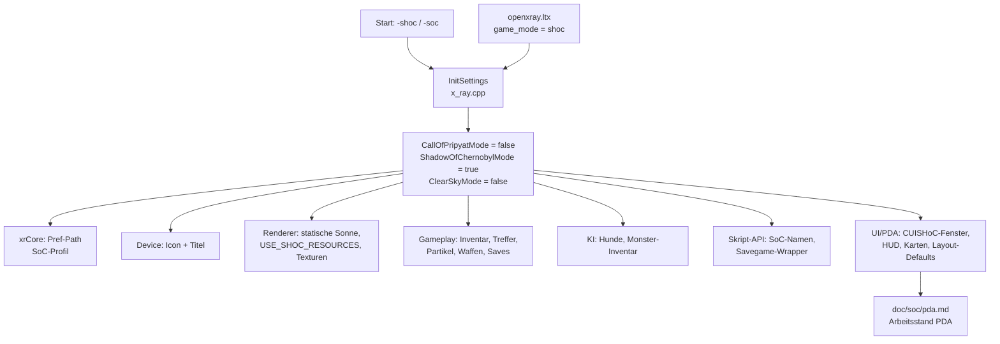

# SHoC-Support: Wo muss man anpassen? (Landkarte)

> Deutsche Entwickler-Dokumentation des OpenXRay/xray-16-Projekts zum **Shadow-of-Chernobyl-(SHoC/SoC)-Support**.
> Pfade relativ zum Projekt-Stammverzeichnis. Zeilennummern sind Schnappschüsse und können sich verschieben — im Zweifel per Grep nach `ShadowOfChernobylMode` suchen.

## 1. Kontext & aktueller Stand

- **Offiziell wird SoC noch nicht unterstützt** (Projekt-README: „Shadow of Chernobyl is **not supported** yet“, Tracker-Issue **#392**). Offiziell unterstützt: CoP 1.6.02, CoC 1.4.22; CS 1.5.10 „in Arbeit“.
- Es existiert bereits eine **Infrastruktur für den SoC-Modus** im Code (Modus-Schalter, Render-Weichen, UI-Sonderfälle) und ein Team-Arbeitsdokument: [`doc/soc/pda.md`](../doc/soc/pda.md) — Stand Branch `soc_dev2` (2026-09-24). Dort lag der Fokus auf dem **PDA** (vier SoC-Fenster neu gebaut: Aufgaben, Tagebuch, Kontakte, Rangliste).
- Freischaltbar über Kommandozeile **oder** Config (siehe unten): SoC läuft damit grundsätzlich im SoC-Modus, aber auf „minor bugs are possible“-Niveau; viele Punkte sind als `XXX` markiert.

## 2. Aktivierung & zentrale Modus-Schalter

### Die drei globalen Flags

```cpp
// src/xrEngine/defines.h (L9-11)
extern ENGINE_API bool CallOfPripyatMode;
extern ENGINE_API bool ClearSkyMode;
extern ENGINE_API bool ShadowOfChernobylMode;

// src/xrEngine/x_ray.cpp (L46-48: Definition, L88-114: Setter)
void set_shoc_mode();   // nur ShadowOfChernobylMode = true
void set_cs_mode();
void set_cop_mode();
void set_free_mode();   // alle aus (dev/„unlock“)
```

### Wo der Modus gesetzt wird

**`src/xrEngine/x_ray.cpp`, `InitSettings()` (L116-150):**

1. Kommandozeile: `-shoc` **oder** `-soc` (SoC), `-cs` (ClearSky), `-cop`, `-unlock_game_mode` (alle frei).
2. Ohne Parameter: Config `openxray.ltx` → `[compatibility] game_mode = cop|cs|shoc|soc|unlock` (Default `cop`).

```ini
; openxray.ltx (in $app_data_root$)
[compatibility]
game_mode = shoc
```

### Sofort-Auswirkungen des Modus (Plattformrahmen)

| Datei | Zweck |
|-------|-------|
| `src/xrCore/xrCore.cpp` (~L206), `src/xrCore/LocatorAPI.cpp` (~L847) | Basis-/Config-/Save-Pfad: `SDL_GetPrefPath("GSC Game World", "S.T.A.L.K.E.R. - Shadow of Chernobyl")` — SoC nutzt eigene User-Verzeichnisse (getrennte Saves/Configs von CoP/CS) |
| `src/xrEngine/Device_Initialize.cpp` (L47-65) | Fenster-Icon (`IDI_ICON_SOC`) und Fenstertitel „S.T.A.L.K.E.R.: Shadow of Chernobyl“ |

## 3. Modul-Landkarte aller SoC-Anpassungspunkte

Vollständig per `grep -rn "ShadowOfChernobylMode" src` (102 Treffer Stand des Branches). Sortiert nach Modul:

### 3.1 Renderer (`src/Layers/xrRender*`)

| Datei:Zeile | Anpassung |
|-------------|-----------|
| `xrRender/Light_DB.cpp:200` | **Statisches Sonnenlicht**: SoC-Levels haben kein dynamisches Sonnenlicht — true sun direction wird im SoC-Modus übersprungen (`!RImplementation.is_sun_static() && !ShadowOfChernobylMode`) |
| `xrRenderPC_GL/rgl_shaders.cpp:426` | Shader-Define `USE_SHOC_RESOURCES=1` für alle Shader-Compilierungen — GL-Shader-Pfad für SoC-Ressourcen |
| `xrRender/Texture.cpp:291` | Fehlende Dummy-Textur wird im SoC-Modus toleriert (kein `R_ASSERT3`), `nullptr` statt Crash |
| `xrRenderDX11/dx11HW.cpp:183` | ClearSkyMode-Prüfung im DX11-Wrapping (CS-Analogon) |

### 3.2 Partikel & Server-Objekte

| Datei:Zeile | Anpassung |
|-------------|-----------|
| `xrParticles/particle_actions_collection_io.cpp:402` | Partikel-Action-Serialisierung unterscheidet SoC-Format |
| `xrServerEntities/object_factory_register.cpp:207` | **Kein `CActorMP`**: SoC registriert `CActor` ohne MP-Variante (`ADD` statt `ADD_MP`) — der CoP-netzwerkfähige Actor existiert in SoC-Spawn nicht |
| `xrServerEntities/object_factory_register.cpp:348` | zweite SoC-Registrierungsschleife (CLSIDs/Aliasse) |

### 3.3 Gameplay (`src/xrGame`)

| Datei:Zeile | Anpassung |
|-------------|-----------|
| `Inventory.cpp:86` | Slot-Aktivität: SoC-Default ist `defaultSlotActiveness[]` (klassisches Slot-Verhalten), CoP `false` |
| `Inventory.cpp:180` | `compatibility:default_to_slot` — Items landen im SoC-Modus defaultmäßig in Slots statt Rucksack |
| `Inventory.cpp:1283` | Gürtelbreite: SoC = fixe `m_iMaxBelt` (keine Outfit-abhängige Artefakt-Anzahl!) |
| `script_game_object_inventory_owner.cpp:1273` | `[compatibility] minus_one_slot_ordering` (SoC/CS-Sortierung) |
| `InfoPortion.cpp:34` | fehlende Info-Portions sind in SoC/CS nur Warnung statt Fehler |
| `ActorInput.cpp:199` | „Item benutzt“-Anzeige 3 s (SoC/CS) statt dauerhaft |
| `PHMovementControl.cpp:107` | Kollisions-Treffer-Typ: `eHitTypePhysicStrike` (SoC/CS) statt `eHitTypeStrike` |
| `ShootingObject.cpp:220,311,349` | **XXX**: Partikelpositionen der SoC-Configs sind für deaktivierten HUD-Modus — CoP-HUD-Waffe bräuchte eigene Pfade; aktuell wird `in_hud_mode = false` erzwungen |
| `Weapon.cpp:536` | **XXX (temporär!)**: `LoadScope` im SoC-Modus ausgesetzt — CoP-Scope-UI `(m_UIScope)` wird nicht geladen |
| `artefact_activation.cpp:186`, `autosave_manager.cpp:79`, `console_commands.cpp:688,710,788`, `map_spot.cpp:41`, `alife_storage_manager.cpp:32,157` | diverse Kompatibilitäts-Weichen (Artefakt-Aktivierung, Autosave, Konsolenbefehle, Map-Spot-Skalierung, **Save/Load-Format von World-Saves**) |

### 3.4 KI & Monster

| Datei:Zeile | Anpassung |
|-------------|-----------|
| `ai/monsters/dog/dog.cpp:29` | SoC-Hunde: `eControlMeleeJump` statt `eControlJump` (Sprungangriff ohne Kopfangriff) |
| `ai/monsters/dog/dog.cpp:166,345` | weitere Hund-Verhaltens-Weichen |
| `ai/monsters/basemonster/base_monster.h:76` | `cast_inventory_owner()` gibt nur im CoP-Modus `this`; SoC/CS-Monster sind keine Inventarbesitzer |
| `ai/monsters/basemonster/base_monster_feel.cpp:128` | Feel-/Touch-Verhalten (3-s-Anzeige) |
| `ai/stalker/ai_stalker_space.h:187` | Stalker-Verhaltenskonstanten (Sicht-/Sound-Reichweiten) |
| `xrgame_dll_detach.cpp:46-47` | InfoPortion/Encyclopedia-Registry-Init mit SoC-Flag (Welt-Rebuild nach Moduswechsel) |

### 3.5 Skript-API (Lua-Bindings)

| Datei:Zeile | Anpassung |
|-------------|-----------|
| `script_game_object3.cpp:595,604,771,805,829` | `game_object`-Export mit SoC/CS-Ausschlüssen (Methoden, die es in SoC nicht gab) |
| `GameTask_script.cpp:64-68` | `set_map_location`/`set_object_id`-Aliasse **für SoC-Skripte** (Original-SoC-Scripts nutzen andere Namen) |
| `saved_game_wrapper.cpp:155` | Savegame-Wrapper liest SoC-Format (`spawns_chunk` 4 fehlt → anderer Pfad) |
| `actor_communication.cpp:66-70` | **XXX (auskommentiert)**: SoC-Enzyklopädie-Anzeige muss zurück in `AddEncyclopediaArticle` bzw. neue Lösung |

### 3.6 UI & PDA (schwerster Block)

| Datei | Anpassung |
|-------|-----------|
| `ui/UIPdaWnd.cpp` + `UIPdaWnd.h:60` | SoC-PDA: Rahmen/fenster `CUISHoC*` (`CUISHoCTaskWnd`, `CUISHoCDiaryWnd`, `CUISHoCContactsWnd`, `CUISHoCRankingWnd`) ersetzen CoP-Fenster; Tab-IDs `"0"`–`"6"`; Details: [`doc/soc/pda.md`](../doc/soc/pda.md) |
| `ui/UIActorMenu*.cpp` (L104, L1001, L1561 …) | Inventar-Menü-Weichen (Slot-Handling; SoC zeigt statische Meldung statt Toast) |
| `ui/UIHudStatesWnd.cpp:85,132,136,517` | HUD: SoC **ohne Rüstungsanzeige** (`progress_bar_armor` wird nicht gesucht), Health-Anzeige anders |
| `ui/UIMap.cpp:401`, `ui/UIMapWnd.cpp:104`, `ui/UIMapWnd2.cpp:24` | Karten-/PDA-Weltkarte: SoC-XML-Pfade und Scroll-Verhalten (`m_scroll_mode`) |
| `ui/UITalkDialogWnd.cpp:53` | Dialogfenster-Layout für SoC |
| `ui/UIGameTutorialSimpleItem.cpp:136-138` | Tutorial-Sonderfälle (SoC/CS) |
| `ui/UILoadingScreenHardcoded.h:189-213` | Ladebildschirme: je Modus andere Layouts (hartkodiert) |
| `ui/UIOutfitInfo.cpp:58` | Rüstungs-Statistiken nur im CoP-Format |
| `xrUICore/ui_base.cpp:11,293` | ui_base registriert SoC-Texturen/Fonts; UIHelper-Flags |
| `xrUICore/XML/UIXmlInitBase.cpp:853` | `stretch_texture`-Default: `0` statt `1` für SoC/CS (XML-Layoutkompatibilität!) |
| `xrUICore/XML/UIXmlInitBase.cpp`: `InitFrameWindow/InitFrameLine` | Fenster-`<title>`-Texte (nur SoC) |

## 4. Bekannte offene Punkte (aus Code & `doc/soc/pda.md`)

**XXX-Marker im Code (im SoC-Modus):**

1. `Weapon.cpp:536` — Scope-Load ausgesetzt („temporary check, to be removed“): braucht SoC-Scope-Lösung statt Rückkehr `return`.
2. `ShootingObject.cpp` (3×) — Partikelpositionen für CoP-HUD-Waffen mit SoC-Configs kombinieren.
3. `actor_communication.cpp` — SoC-Enzyklopädie-UI-Anzeige auskommentiert, muss umgebaut werden.
4. `inventory_upgrade_root.cpp:140` — Clear-Sky-Upgrade-Parsing („XXX: find a dynamic, universal solution“); SoC besitzt gar kein Upgrade-System, die Upgrade-UI-Stellen prüfen `ClearSkyMode` (`UIInvUpgradeInfo.cpp`).

**Behoben am 25.09.2026 — Archive-Lookup-Fehler (`CLocatorAPI::LoadArchive`):** Der frühe `$app_root$`-Scan mountet `.db*`-Archive aus dem Binary-Ordner, bevor `$fs_root$` existiert; dadurch registrierten sich alle Archiv-Einträge mit relativem `gamedata\…`-Prefix und waren für absolute Lookups unsichtbar (`Cannot find … system.ltx`). Fix: Basis-Pfad-Rückgriff auf den Ordner der Archivdatei (17 Zeilen, nur `src/xrCore/LocatorAPI.cpp`). Headless verifiziert: neues Spiel startet, 120+ Skripte, Level l01_escape, 0 FATALs. Details: `docs/10-shoc-testprotokoll.md`, Abschnitt 3a.

**Offene Punkte aus `doc/soc/pda.md`:**

1. In-Game-Test aller PDA-Tabs (Karte & Statistik „ungetestet“).
2. Tooltips an Aufgaben-Buttons (`hint`-Attribute in `pda_events.xml`/`job_item.xml`).
3. Symbole neu/gelesen im Tagebuch (aktuell Farbmarkierung).
4. Überflüssige Style-Dateien in `ui_style_shoc` klären (`pda_tasks.xml`, `pda_logs.xml`, `pda_ranking.xml` sind CoP-Format, `backup.xml` ist Kopie).
5. Alte Savegames können an Skript-Fehlern im Aufgabensystem scheitern (siehe #392).

## 5. Praktischer Workflow für SoC-Änderungen

1. **Modus aktivieren:** Startparameter `xr_3da -shoc` (oder `-soc`) bzw. `game_mode = shoc` in der `openxray.ltx` des Profils — nutze eine separate Spielinstallation.
2. **Sofort-Test:** neues Spiel direkt, ohne Hauptmenü (aus `doc/soc/pda.md`):
   ```
   xr_3da -nointro -shoc -start 'server(all/single/alife/new)' 'client(localhost)'
   ```
3. **Log beobachten:** nach `!`- und `FATAL`-Zeilen filtern; `dump_config_file <pfad> <ziel>` schreibt Original-XMLs (z. B. `ui\pda_events.xml`) zur Referenz auf die Platte.
4. **Original-Referenzquellen** (alte SoC-Fenster, 2015 gelöscht): auslesbar via
   ```
   git show 28cd2555a~1:src/xrGame/ui/UIEventsWnd.cpp   # usw. (Liste in doc/soc/pda.md)
   ```
5. **Neue Weichen anlegen:** dem bestehenden Muster folgen — `if (ShadowOfChernobylMode)` bzw. `const bool compat = ClearSkyMode || ShadowOfChernobylMode;`; konfigurierbare Extras über `[compatibility]` in `openxray.ltx` (`pSettingsOpenXRay->read_if_exists<bool>("compatibility", …)`).
6. **Vorsicht bei Asset-Abhängigkeiten:** SoC nutzt alte Formate/statische Sonne/hartkodierte Pfade — Änderungen in Renderpfaden (`Light_DB`, `rgl_shaders`) und Save/Load (`alife_storage_manager`, `saved_game_wrapper`) immer in **beiden** Modi testen (Regressionsrisiko CoP/CS).
7. **Modus-Wechsel beachten:** Modusflags sind global — ein Wechsel des `game_mode` (oder Startparameter) erfordert Neustart; User-Verzeichnisse sind getrennt (SDL-Pref-Path), Savegames von CoP laufen nicht an.

## 6. Zusammenfassung als Schaubild



## 7. Referenzen

- Tracker-Issue **#392** („Support Shadow of Chernobyl“) — zentrale Todo-Liste des SoC-Supports.
- Branch **`soc_dev2`** — dort wird SoC aktiv entwickelt (dokumentierter Stand in `doc/soc/pda.md`).
- [`doc/soc/pda.md`](../doc/soc/pda.md) — detaillierter PDA-Arbeitsstand mit Original-Referenzen.
- Diese Doku: [`docs/03-rendering.md`](03-rendering.md) (Shader/Lichter), [`docs/04-engine-systeme.md`](04-engine-systeme.md) (Device/Init), [`docs/05-spiellogik.md`](05-spiellogik.md) (Gameplay/KI), [`docs/06-scripting-ui-ki.md`](06-scripting-ui-ki.md) (UI).

---
*Basis: `grep -rn "ShadowOfChernobylMode|ClearSkyMode|CallOfPripyatMode"` (102 Treffer), Volltextlese von `x_ray.cpp` L40-200, `doc/soc/pda.md`, sowie Auszüge aus `object_factory_register.cpp`, `dog.cpp`, `rgl_shaders.cpp`, `Device_Initialize.cpp`, `Inventory.cpp`, `Weapon.cpp` u. a.*
