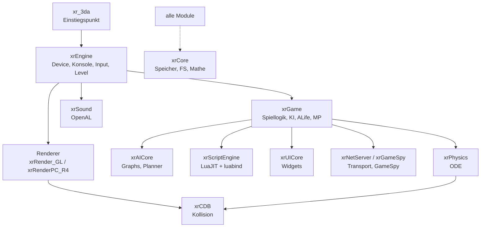

# OpenXRay/xray-16 – Deutsche Entwickler-Dokumentation

Diese Sammlung beschreibt die Architektur und alle Module des OpenXRay-Projekts – in deutscher Sprache, für Entwickler und Modder, die die Engine kennenlernen bzw. erweitern wollen. Die Dokumentation ist **modulorientiert**: Sie erklärt Zweck, Struktur, Kernkomponenten und Zusammenspiel der einzelnen Bibliotheken – keine Datei-für-Datei-Referenz.

> Projekt-Regeln für KI-/Agent-Arbeit stehen separat in [`CLAUDE.md`](../CLAUDE.md); die offizielle API-Dokumentation lässt sich per Doxygen (`doc/doxygen/Doxyfile`) generieren.

## Das Projekt in Kürze

**OpenXRay** ist eine modernisierte Open-Source-Version der X-Ray-Engine 1.6.02 (S.T.A.L.K.E.R.: Call of Pripyat). Ziele: ~99 % Kompatibilität zu Original-Assets, Bugfixes, mehr Performance, Cross-Platform (Windows, Linux, macOS, BSD; x86, ARM, …), 64-Bit. Unterstützte Spiele: **Call of Pripyat 1.6.02**, **Call of Chernobyl 1.4.22**, **Clear Sky 1.5.10** (in Arbeit); Shadow of Chernobyl ist noch nicht unterstützt.

| Kennzahl | Wert |
|----------|------|
| Sprache | C++17 |
| Build-System | CMake ≥ 3.23 |
| Quellzeilen (Engine, ohne `Externals/`) | ~667.000 |
| Größtes Modul | `src/xrGame` (~2.350 Dateien) |
| Renderer | OpenGL (`xrRender_GL`, überall) und DirectX 11 (`xrRenderPC_R4`, Windows) |

## Architektur-Überblick



Zentrale Konzepte, die überall auftauchen:

- **`GEnv`** (`src/Include/xrAPI/xrAPI.h`): globale Umgebung (Service Locator) mit Zeigern auf `Render`, `DRender`, `UIRender`, `RenderFactory`, `ScriptEngine`, `AISpace`, `Sound`, `UI` und `isDedicatedServer`.
- **Renderer-Module**: Jedes Backend exportiert `GetRendererModule()`; die Engine wählt beim Start per `CEngineAPI::SelectRenderer()` einen Modus (`renderer_r2 … renderer_rgl`) und füllt `GEnv` mittels `SetupEnv()`.
- **`FS`/VFS**: virtuelles Dateisystem (`xrCore/LocatorAPI`) über `*.db*`-Archive und logische Pfade wie `$game_data$`, `$game_shaders$`, `$game_scripts$`.
- **`shared_str`** (referenzgezählte Strings), **`xr_new`/`xr_delete`** (zentrale Speicherverwaltung), **`CInifile`** (`.ltx`-Config-Parser).
- **Schnittstellen-Trennung**: `src/Include/xrRender` definiert die Renderer-API, `xrEngine` definiert `IGame_Level`/`IGame_Persistent` (Implementierung in `xrGame`) – dadurch sind Engine, Renderer und Spiel entkoppelt.


## Dokumentations-Index

| Kapitel | Inhalt |
|---------|--------|
| [02 – Foundation](02-foundation.md) | `xrCore` (Speicher, VFS, Mathe, Strings, Kompression, Krypto, Threading, Animation-Datenmodell), `xrCommon`, `src/Common`, `src/Include` |
| [03 – Rendering](03-rendering.md) | Renderer-Auswahl & `GEnv`, geteilter Kern (`Layers/xrRender`), Deferred-Pipeline (`xrRender_R2`), GL/DX11-Backends, `xrMaterialSystem`, `xrAPI` |
| [04 – Engine-Systeme](04-engine-systeme.md) | `xr_3da`-Einstieg, `xrEngine` (Device, Konsole, Camera, Environment, Scheduling), `xrCDB`, `xrPhysics`, `xrParticles`, `xrSound` |
| [05 – Spiellogik](05-spiellogik.md) | `xrGame`: Actor, Waffen/Items, KI (Stalker/Monster/Smart Covers), ALife-Simulation, Multiplayer (Client/Server), Lua-Bindings, `ui/` |
| [06 – Scripting, UI, KI-Kern](06-scripting-ui-ki.md) | `xrScriptEngine` (LuaJIT/luabind, Debugger, Profiler), `xrUICore` (Widgets, XML), `xrAICore` (Game/Level-Graphs, A*/Dijkstra, GOAP-Planer) |
| [07 – Netzwerk](07-netzwerk.md) | `xrNetServer` (Transport), `xrServerEntities` (Serialisierung/Fabriken), `xrGameSpy` (QR2, GCD, GP, ATLAS), MP-Architektur & Anti-Cheat |
| [08 – Tools & Build](08-tools-build.md) | CMake-System, Konfigurationen, Targets, `Externals/`-Submodule, Utils (`xrCompress`, `xrLC_Light`, MP-Tools), Editoren, CI |
| [09 – SHoC-Support](09-shoc-anpassungen.md) | Landkarte aller Shadow-of-Chernobyl-Anpassungspunkte: Modus-Schalter (`ShadowOfChernobylMode`, `-shoc`/`openxray.ltx`), Renderer, Gameplay, KI, UI/PDA, offene `XXX`-Punkte, Test-Workflow |
| [10 – SHoC-Testprotokoll](10-shoc-testprotokoll.md) | Reproduzierbares Test-Setup (portabler SoC-Lauf im `bin/`-Ordner), Startbefehle, Durchklick-Checkliste, Log-Analyse-Kommandos, Findings aus dem 24.09.-Lauf |

## Schnellstart (Build)

```bash
git submodule update --init --recursive
cmake -B build -DCMAKE_BUILD_TYPE=Release -DBUILD_SHARED_LIBS=ON -DXRAY_USE_LUAJIT=ON
cmake --build build -j$(nproc)
# Binary: build/bin/<Arch>/Release/xr_3da
```

Details (Debug, ASan, Tracy, Einstellungen) in [Kapitel 08](08-tools-build.md); Spiel-Installation/Kompatibilität: offizielle README/Wiki des Projekts.

## Einstiegspunkte fürs Code-Lesen

| Interesse | Startpunkt |
|-----------|------------|
| Startup/Frame-Lebenszyklus | `src/xr_3da/entry_point.cpp` → `src/xrEngine/x_ray.cpp` |
| Renderer-Erweiterung | `src/Include/xrRender/` → `src/Layers/xrRender/` → `src/Layers/xrRenderPC_GL/` |
| Gameplay/Verhalten | `src/xrGame/GameObject.cpp` → `Actor.cpp` / `ai/` |
| Lua-API | `src/xrScriptEngine/script_engine.cpp` + beliebige `*_script.cpp` |
| Multiplayer | `src/xrGame/xrServer.cpp`, `game_sv_base.cpp` |
| Tools/Assets | `src/utils/xrCompress`, `xrLC_Light` |

## Konventionen & Richtlinien

- Code- und Kommentar-Stil: `doc/procedure/cpp_code.txt`, `cpp_comment.txt` (historische GSC-Richtlinien).
- Neue Quelldateien gehören in die CMake-Quelllisten des jeweiligen Moduls.
- Plattform-Code zentral in `src/Common/Platform*.inl` pflegen statt verstreuter `#ifdef`s.

## Status & weiteres

- Stand der Dokumentation: **Modul-Ebene** (Struktur + Kernkomponenten; September-Status des `dev`-Branches). Vertiefungen (z. B. Serialisierungsformat, Shader-Blender-Details, Net-Protokoll-Bits) sind bewusst knapp gehalten; die Fußnoten je Kapitel nennen die Quellen für weiteres Vertiefen.
- Für Detail-Doku pro Klasse Doxygen verwenden; für Änderungen am Verhalten gilt: Vanilla-Kompatibilität hat Vorrang (siehe README.md des Projekts).

---
*Dokumentation wurde aus den Verzeichnislisten, den `CMakeLists.txt`-Dateien und gezielten Quellcode-Lese-Auszügen des Projekts erstellt. Einzelheiten sind mit den jeweiligen Referenzen im Fließtext und den Fußnoten je Kapitel hinterlegt.*
